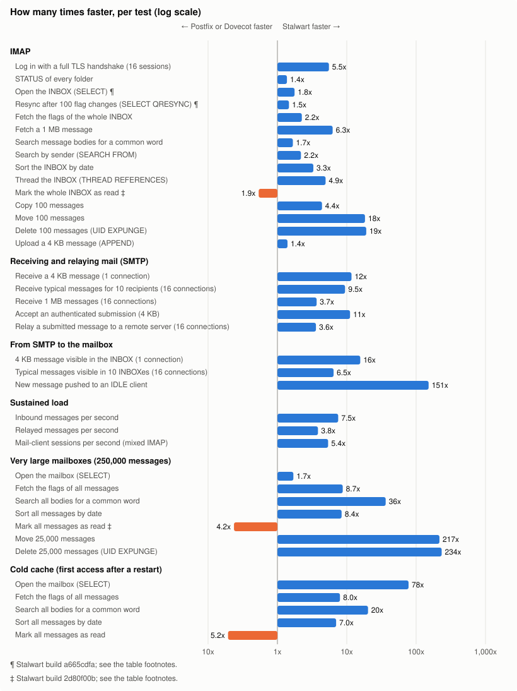
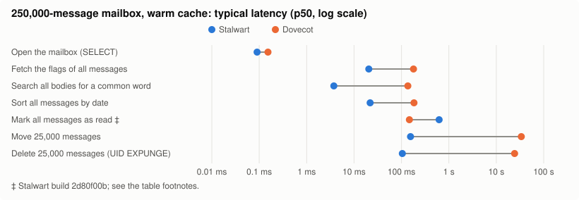

# Stalwart benchmarks

This repository holds performance benchmarks of [Stalwart](https://stalw.art), the open-source mail and collaboration server, against other mail server software, and of the different storage backends Stalwart supports. Every script, configuration, test scenario and raw result is here, so anyone can check or repeat the numbers.

> The head-to-head comparison below is the published result. The storage backend benchmarks are still in preparation.

## Repository contents

| Part | What it measures | Status |
|---|---|---|
| **Head-to-head comparison** | Stalwart against Postfix (SMTP) and Dovecot (IMAP), each running on one server | results below |
| **Storage backend benchmarks** | Stalwart on its different storage backends (for example RocksDB, PostgreSQL, FoundationDB, S3-compatible blob storage) and in clustered setups | in preparation |

## Summary

We installed Stalwart v1.0 on one cloud server and Postfix 3.11.7 with Dovecot 2.4.5 on an identical one, loaded both with the same mailboxes and sent both exactly the same work: receiving mail, delivering it, and serving it to mail clients over IMAP. Both ran with comparable settings (same encryption, same password hashing, same search features, spam filtering off on both), and the two were measured alternately on the same hardware (a few load-test ladders are compared across two identical server pairs; see the caveats).

**How to read "N times faster".** For most tests we measure how long one operation takes and compare the typical (median) time: if Stalwart needs 1 ms and Dovecot 5 ms, Stalwart is 5x faster. For load tests we compare the highest rate each system can sustain while still answering quickly. "About equal" means less than 1.1x apart.

<!-- readme:tally:begin -->
Across the 38 headline comparisons measured, Stalwart is faster in 35, Postfix or Dovecot in 3, 0 are about equal, and 0 are not separated because both systems still kept up at the highest load tried.

<!-- readme:tally:end -->



‡ and ¶ mark rows measured with Stalwart builds 2d80f00b and a665cdfa; see the table footnotes.

## Results by category

Postfix handles SMTP (receiving and sending mail) and Dovecot handles IMAP (mail clients), so each category compares Stalwart with the product that does that job. Delivery from SMTP into the mailbox involves both.

### IMAP: what mail clients do (Stalwart vs Dovecot)

<!-- readme:cat:imap:begin -->
**IMAP: Stalwart is faster than Dovecot in 14 of 15 tests, by 1.4x to 19x.**

Typical latency (p50), lower is better.

| Test | Stalwart | Dovecot | Faster |
|---|---|---|---|
| Log in with a full TLS handshake (16 sessions) | 5.12 ms | 28.3 ms | **Stalwart**, 5.5x |
| STATUS of every folder | 0.638 ms | 0.876 ms | **Stalwart**, 1.4x |
| Open the INBOX (SELECT) ¶ | 0.064 ms | 0.113 ms | **Stalwart**, 1.8x |
| Resync after 100 flag changes (SELECT QRESYNC) ¶ | 0.135 ms | 0.198 ms | **Stalwart**, 1.5x |
| Fetch the flags of the whole INBOX | 0.089 ms | 0.200 ms | **Stalwart**, 2.2x |
| Fetch a 1 MB message | 0.650 ms | 4.07 ms | **Stalwart**, 6.3x |
| Search message bodies for a common word | 0.133 ms | 0.222 ms | **Stalwart**, 1.7x |
| Search by sender (SEARCH FROM) | 0.071 ms | 0.155 ms | **Stalwart**, 2.2x |
| Sort the INBOX by date | 0.091 ms | 0.300 ms | **Stalwart**, 3.3x |
| Thread the INBOX (THREAD REFERENCES) | 0.095 ms | 0.470 ms | **Stalwart**, 4.9x |
| Mark the whole INBOX as read ‡ | 0.464 ms | 0.249 ms | **Dovecot**, 1.9x |
| Copy 100 messages | 0.289 ms | 1.27 ms | **Stalwart**, 4.4x |
| Move 100 messages | 0.638 ms | 11.7 ms | **Stalwart**, 18x |
| Delete 100 messages (UID EXPUNGE) | 0.586 ms | 11.2 ms | **Stalwart**, 19x\* (median 20x) |
| Upload a 4 KB message (APPEND) | 0.238 ms | 0.333 ms | **Stalwart**, 1.4x |

\* In these tests Dovecot's result changes from one repetition to the next, because state accumulates on the Dovecot side between repetitions. The factor shown comes from the repetition least favourable to Stalwart; the median over the reported repetitions follows in brackets. Details: [report/CAVEATS.md](report/CAVEATS.md#6-state-accumulation-in-dovecots-mdbox).

¶ Stalwart build a665cdfa, measured on cluster c3 in one session with Postfix + Dovecot: 3 runs per system, interleaved; unmarked rows use build f976519d ([CAVEATS.md, section 10](report/CAVEATS.md#10-build-and-configuration-differences)).

‡ Stalwart build 2d80f00b, measured in one session with Postfix + Dovecot on the same cluster: 2 Stalwart and 4 Postfix + Dovecot runs on the large mailboxes, 1 run each on the regular mailboxes; unmarked rows use build f976519d ([CAVEATS.md, section 10](report/CAVEATS.md#10-build-and-configuration-differences)).

<!-- readme:cat:imap:end -->

### SMTP: receiving and relaying mail (Stalwart vs Postfix)

<!-- readme:cat:smtp:begin -->
**Receiving and relaying mail (SMTP): Stalwart is faster than Postfix in all 5 tests, by 3.6x to 12x.**

Typical latency (p50) from TCP connect to the server's 250 reply, lower is better.

| Test | Stalwart | Postfix | Faster | Faster with a quickack client |
|---|---|---|---|---|
| Receive a 4 KB message (1 connection) | 3.84 ms | 45.0 ms | **Stalwart**, 12x | **Stalwart**, 1.5x |
| Receive typical messages for 10 recipients (16 connections) | 7.97 ms | 75.3 ms | **Stalwart**, 9.5x | **Stalwart**, 3.7x |
| Receive 1 MB messages (16 connections) | 17.5 ms | 64.2 ms | **Stalwart**, 3.7x (at p99: Postfix 3.9x faster) | **Stalwart**, 2.4x |
| Accept an authenticated submission (4 KB) | 3.94 ms | 44.0 ms | **Stalwart**, 11x | **Stalwart**, 1.5x |
| Relay a submitted message to a remote server (16 connections) | 16.4 ms | 58.9 ms | **Stalwart**, 3.6x | **Stalwart**, 2.2x |

<!-- readme:cat:smtp:end -->

Most of the difference here comes from one Postfix behaviour: after about 73% of TLS handshakes (in a packet-capture diagnostic on one cluster, [results/c-probe-check/tls-stall/c20/](results/c-probe-check/tls-stall/c20/)), Postfix's first reply waits about 40 ms for the client's TCP acknowledgement. It is built into Postfix and cannot be configured away, and clients with the default Linux network stack see it; a client that acknowledges immediately does not. The numbers above are end to end, as a typical client sees them; the last column repeats the comparison with a client that acknowledges immediately (a diagnostic run on a different pair of VMs, [details](report/RESULTS.md#postfixs-40-ms-stall-after-the-tls-handshake)). The message transaction alone (MAIL FROM to the 250 reply), which the stall does not touch, is in the detailed tables: for a 4 KB message on one connection Stalwart is 2.8x faster there. [Why the stall happens](report/RESULTS.md#postfixs-40-ms-stall-after-the-tls-handshake).

### From SMTP to the mailbox (Stalwart vs Postfix + Dovecot)

<!-- readme:cat:delivery:begin -->
**From SMTP to the mailbox: Stalwart is faster than Postfix + Dovecot in all 3 tests, by 6.5x to 151x.**

Typical latency (p50) from the sender's TCP connect until the message is visible to an IMAP client, lower is better.

| Test | Stalwart | Postfix + Dovecot | Faster | Faster with a quickack client |
|---|---|---|---|---|
| 4 KB message visible in the INBOX (1 connection) | 3.00 ms | 46.9 ms | **Stalwart**, 16x | **Stalwart**, 2.3x |
| Typical messages visible in 10 INBOXes (16 connections) | 49.0 ms | 316 ms | **Stalwart**, 6.5x | **Stalwart**, 3.7x |
| New message pushed to an IDLE client | 3.31 ms | 501 ms | **Stalwart**, 151x | **Stalwart**, 131x |

<!-- readme:cat:delivery:end -->

These numbers run from the moment the sender connects until a mail client can see the message, so they include the SMTP part above. For IDLE (push to a waiting client), Dovecot waits a fixed 500 ms by design before it notifies the client, and on its mdbox storage some notifications fall back to a 30 s poll; the typical value shown is the 500 ms case ([details](report/RESULTS.md#2-c2-smtp-to-inbox-delivery-latency)).

### Sustained load

<!-- readme:cat:throughput:begin -->
**Sustained load: Stalwart handles more load than Postfix or Dovecot in all 3 tests, by 3.8x to 7.5x.**

Highest load that still met the service level (p99 under 1 s, 500 ms for mixed IMAP sessions, at most 0.1% errors), higher is better.

| Test | Stalwart | Postfix or Dovecot | Higher |
|---|---|---|---|
| Inbound messages per second (vs Postfix) | 5,445 messages/s | 723.1 messages/s | **Stalwart**, 7.5x\* (median 21x) |
| Relayed messages per second (vs Postfix) | 1,984 messages/s | 516.5 messages/s | **Stalwart**, 3.8x |
| Mail-client sessions per second (mixed IMAP) (vs Dovecot) | 2,178 sessions/s | 405.0 sessions/s | **Stalwart**, 5.4x |

\* In these tests Dovecot's result changes from one repetition to the next, because state accumulates on the Dovecot side between repetitions. The factor shown comes from the repetition least favourable to Stalwart; the median over the reported repetitions follows in brackets. Details: [report/CAVEATS.md](report/CAVEATS.md#6-state-accumulation-in-dovecots-mdbox).

<!-- readme:cat:throughput:end -->

Connection-heavy load (10 messages per connection): neither system sustains it cleanly at high rates, so there is no single number for it; see [the per-step table](report/RESULTS.md#3-c3-smtp-inbound-throughput).

### Very large mailboxes

A single mailbox with 250,000 messages, the kind of mailbox that makes servers slow.

<!-- readme:cat:large:begin -->
**Very large mailboxes (250,000 messages): Stalwart is faster than Dovecot in 6 of 7 tests, by 1.7x to 234x.**

Typical latency (p50) with a warm cache, lower is better.

| Test | Stalwart | Dovecot | Faster |
|---|---|---|---|
| Open the mailbox (SELECT) | 0.090 ms | 0.153 ms | **Stalwart**, 1.7x |
| Fetch the flags of all messages | 20.5 ms | 179 ms | **Stalwart**, 8.7x |
| Search all bodies for a common word | 3.75 ms | 136 ms | **Stalwart**, 36x |
| Sort all messages by date | 21.8 ms | 184 ms | **Stalwart**, 8.4x |
| Mark all messages as read ‡ | 622 ms | 147 ms | **Dovecot**, 4.2x |
| Move 25,000 messages | 156 ms | 33,751 ms | **Stalwart**, 217x\* (median 222x) |
| Delete 25,000 messages (UID EXPUNGE) | 104 ms | 24,330 ms | **Stalwart**, 234x\* (median 242x) |

\* In these tests Dovecot's result changes from one repetition to the next, because state accumulates on the Dovecot side between repetitions. The factor shown comes from the repetition least favourable to Stalwart; the median over the reported repetitions follows in brackets. Details: [report/CAVEATS.md](report/CAVEATS.md#6-state-accumulation-in-dovecots-mdbox).

‡ Stalwart build 2d80f00b, measured in one session with Postfix + Dovecot on the same cluster: 2 Stalwart and 4 Postfix + Dovecot runs on the large mailboxes, 1 run each on the regular mailboxes; unmarked rows use build f976519d ([CAVEATS.md, section 10](report/CAVEATS.md#10-build-and-configuration-differences)).

<!-- readme:cat:large:end -->



‡ marks rows measured with Stalwart build 2d80f00b; see the table footnotes.

### Cold cache

The first operation on a large mailbox right after both servers were restarted and the operating system's file cache was emptied, as after a reboot.

<!-- readme:cat:cold:begin -->
**Cold cache (first access after a restart): Stalwart is faster than Dovecot in 4 of 5 tests, by 7.0x to 78x.**

Median of 10 samples, each the first operation after both servers were restarted with an empty page cache, lower is better.

| Test | Stalwart | Dovecot | Faster |
|---|---|---|---|
| Open the mailbox (SELECT) | 1.90 ms | 148 ms | **Stalwart**, 78x |
| Fetch the flags of all messages | 21.7 ms | 173 ms | **Stalwart**, 8.0x |
| Search all bodies for a common word | 7.67 ms | 155 ms | **Stalwart**, 20x |
| Sort all messages by date | 29.6 ms | 208 ms | **Stalwart**, 7.0x |
| Mark all messages as read | 797 ms | 155 ms | **Dovecot**, 5.2x |

<!-- readme:cat:cold:end -->

## Cases where Postfix or Dovecot is faster

Stalwart is not faster everywhere, and these are the cases where Postfix or Dovecot wins or the two are level:

<!-- readme:wins:begin -->
- **Dovecot** is 1.9x faster. Mark the whole INBOX as read ‡: 0.249 ms against 0.464 ms for Stalwart.
- At p99 (the slowest 1% of operations), **Postfix** is 3.9x faster. Receive 1 MB messages (16 connections): p99 145 ms against 561 ms for Stalwart; at the median Stalwart is faster.
- **Dovecot** is 4.2x faster. Mark all messages as read (250,000-message mailbox, warm cache) ‡: 147 ms against 622 ms for Stalwart.
- **Dovecot** is 5.2x faster. Mark all messages as read (250,000-message mailbox, cold cache): 155 ms against 797 ms for Stalwart.

<!-- readme:wins:end -->

A word on each. Marking every message as read (`STORE +FLAGS \Seen` on all messages) is the clearest case where Dovecot wins: on the regular INBOX, on every large-mailbox size tested, and with a cold cache. When 16 connections send 1 MB messages at once, Stalwart is faster for the typical message but its slowest 1% take longer than Postfix's. With the default storage, each message blob is written to disk twice (the RocksDB write-ahead log and the blob file), so at high 1 MB write rates the server's disk bandwidth limits it and RocksDB briefly throttles writes, which shows in the slowest 1%. Storing blobs on the filesystem instead avoids this. On SMTP, most of Postfix's connection time is the 40 ms stall described above.

## Things to keep in mind

- **Durability is not identical.** Postfix always writes each incoming message to disk with an fsync before confirming it; Stalwart and Dovecot (as configured here) do not. That favours Stalwart on SMTP. A Dovecot variant with full fsync is published for the write tests.
- **Connection-heavy load** (10 messages per connection) has no headline number, because both systems fail sessions at high rates while still meeting the per-message SLO; the step-by-step data is in the detailed results.
- **Postfix's TLS stall and Dovecot's IDLE fallback** are real product behaviours that dominate some tests on a fast network. They are explained, not removed.
- **Dovecot slows down with leftover state.** In the tests that move or delete 10% of a large mailbox, in some EXPUNGE tests on regular mailboxes and in SMTP inbound throughput, Dovecot's result changes from one repetition to the next, even where every repetition is cleaned up with `doveadm purge`; for those the comparison uses the repetition least favourable to Stalwart, with the median next to it ([details](report/CAVEATS.md#6-state-accumulation-in-dovecots-mdbox)).
- **Dovecot's full-text indexing adds 1 s waits** in some single-session MOVE and EXPUNGE tests, because we turned on indexing at arrival (`fts_autoindex = yes`, off in a stock install) to match Stalwart, and its index lock is retried in fixed 1 s steps ([details](report/CAVEATS.md#3-durability-is-not-identical)).
- **One server each.** No replication or clustering in this comparison; those are part of the storage backend benchmarks.
- **Network symmetry.** Round trips to the two servers differ by at most 10 us on every cluster except three, which are listed with the tests they ran in [the caveats](report/CAVEATS.md#8-clusters-network-symmetry-and-repetitions).
- **Stalwart is compiled for the exact CPU**, Postfix and Dovecot are the standard builds.
- **Cloud servers and synthetic mail.** Results come from Azure VMs, and the message text is generated, not real mail.

Every caveat, with the details, is in [report/CAVEATS.md](report/CAVEATS.md).

## Test method

- **Hardware.** Identical Azure Standard_D8ads_v7 servers (8 vCPU AMD EPYC 9V45 "Zen 5", 32 GiB RAM, local NVMe), two load generators and a relay target, all in one placement group with network round trips of about 50 to 90 microseconds. The tests ran on many such clusters in parallel; within a test, both systems share the same pair of servers, except for a few load-test ladders listed in the caveats.
- **Software.** Stalwart at commit `90b8620c` (v1.0.0) built for Zen 5 with RocksDB storage; Postfix 3.11.7 and Dovecot 2.4.5 with mdbox and full-text search. TLS 1.3 with the same certificate and cipher on both.
- **Data.** 1,000 users with realistic mailbox sizes (192,683 messages), plus mailboxes with 10,000, 100,000 and 250,000 messages, generated from a fixed seed and identical on both systems.
- **Procedure.** Each test alternates the two systems one repetition at a time (3 repetitions for most tests) after a 60 s warm-up, with up to 10,000 timed operations per repetition (fewer for slow operations; see [report/CAVEATS.md](report/CAVEATS.md#7-time-caps-reduce-some-sample-counts)). Background work is drained before every run. Results are the median over repetitions; tests whose repetitions disagree by more than 10% are flagged.
- **Load tests.** Requests arrive at a fixed random rate that grows step by step until the system no longer answers 99% of requests within 1 s (500 ms for mixed IMAP sessions) with at most 0.1% errors.

Full methodology: [report/METHODOLOGY.md](report/METHODOLOGY.md).

## Detail files

| File | Contents |
|---|---|
| [report/RESULTS.md](report/RESULTS.md) | every test with p50, p95 and p99, sample counts, errors and the spread between repetitions; scaling charts; the TLS stall and IDLE explanations |
| [report/METHODOLOGY.md](report/METHODOLOGY.md) | hardware, clusters and network round trips, versions, the Stalwart build, dataset, load generation, validity rules, statistics, result files |
| [report/CAVEATS.md](report/CAVEATS.md) | everything that limits or qualifies the comparison |
| [report/FAIRNESS.md](report/FAIRNESS.md) | durability, work per message, known differences, and the symmetry checklist for Postfix and Dovecot reviewers |
| [report/SETTINGS.md](report/SETTINGS.md) | every setting changed from the shipped defaults, with the reason |
| [report/REPRODUCE.md](report/REPRODUCE.md) | how to run it yourself |

## Reproduce

```sh
infra/azure/up.sh infra/topologies/c.json --run bench-c1 --location main=westus3
STALWART_BINARY=/path/to/stalwart BENCH_SCENARIOS=scenarios/c \
BENCH_SCENARIO_PROFILE=scenarios/profiles/c-reduced.yaml BENCH_SCENARIO_GROUP=c1 \
  scripts/run-track.sh work/bench-c1/hosts.json
scripts/readme-tables.sh   # regenerates the tables and charts from results/c/
infra/azure/down.sh infra/topologies/c.json --run bench-c1
```

`versions.env` pins every component. Upstream has no v1.0 tag yet, so `STALWART_REF='v1.0.0'` there is a placeholder. Build the benchmarked commit with rustc 1.98.0, or pass a prebuilt binary. See [report/REPRODUCE.md](report/REPRODUCE.md).
