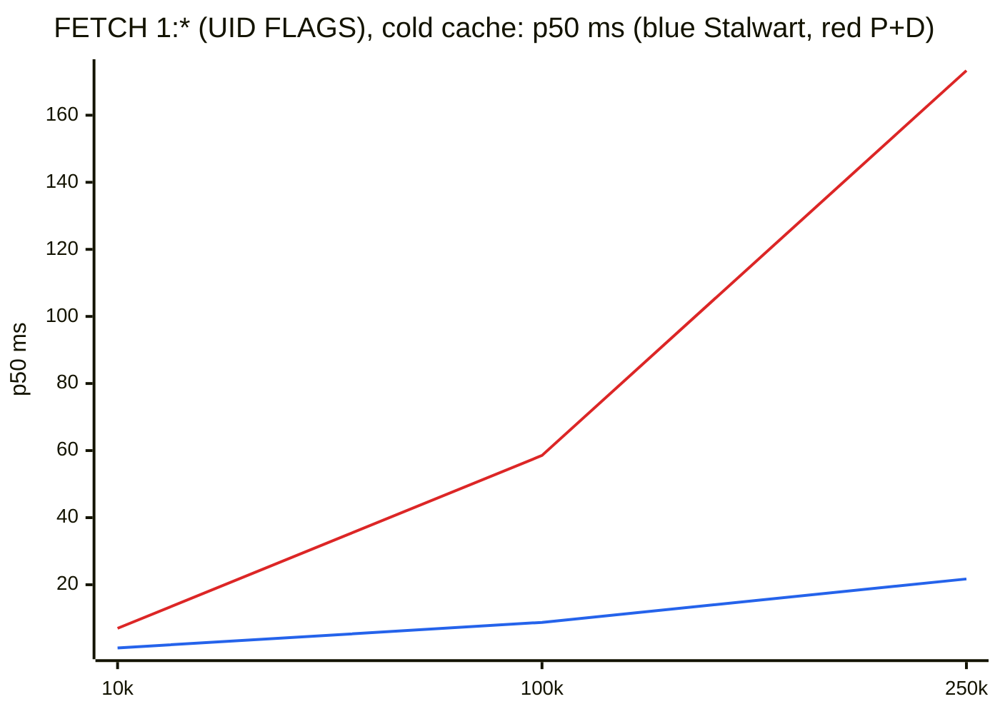
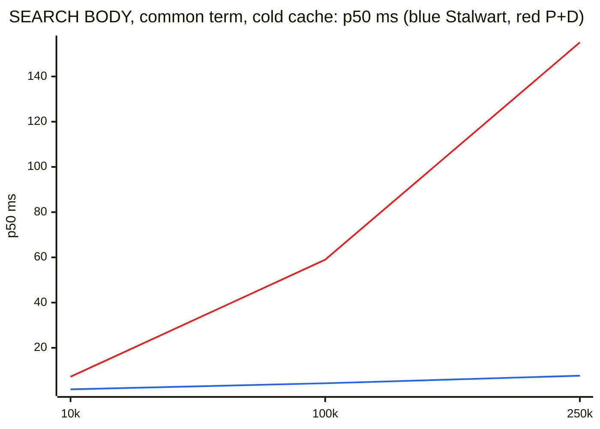
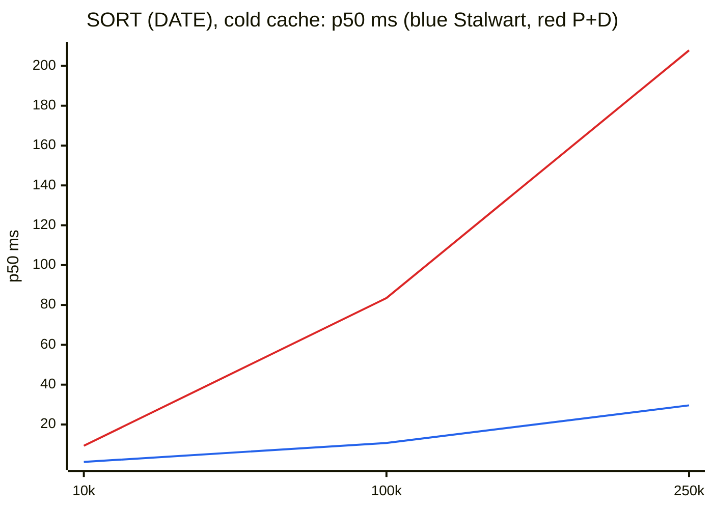
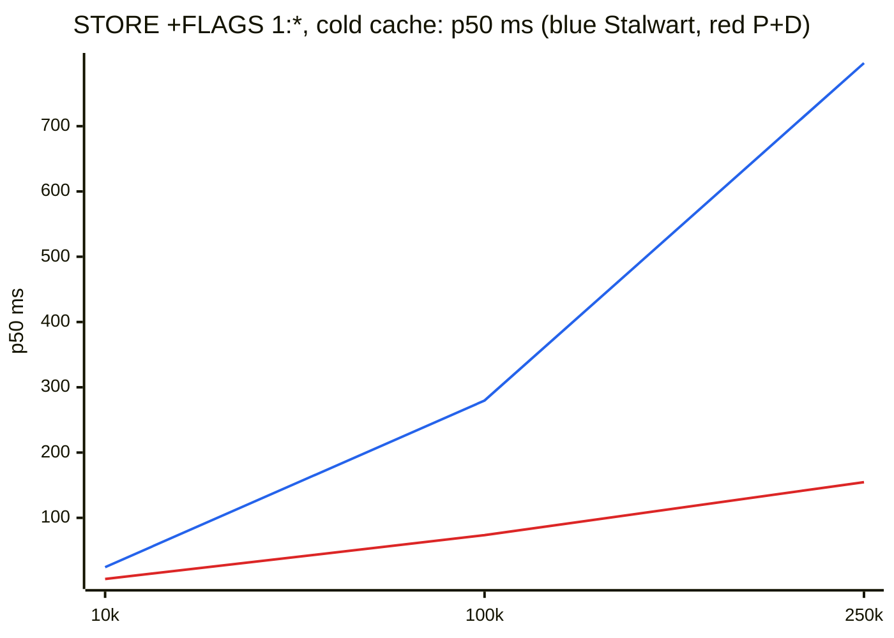
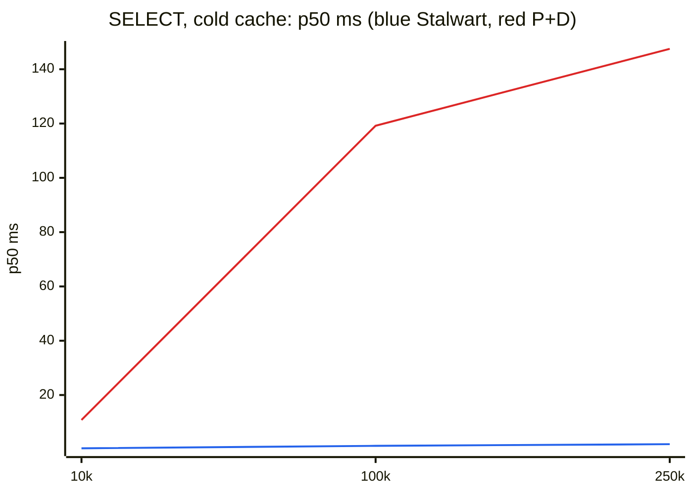
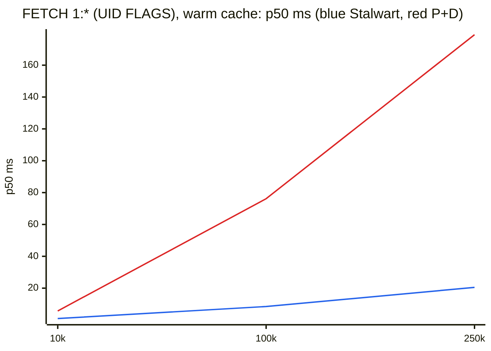
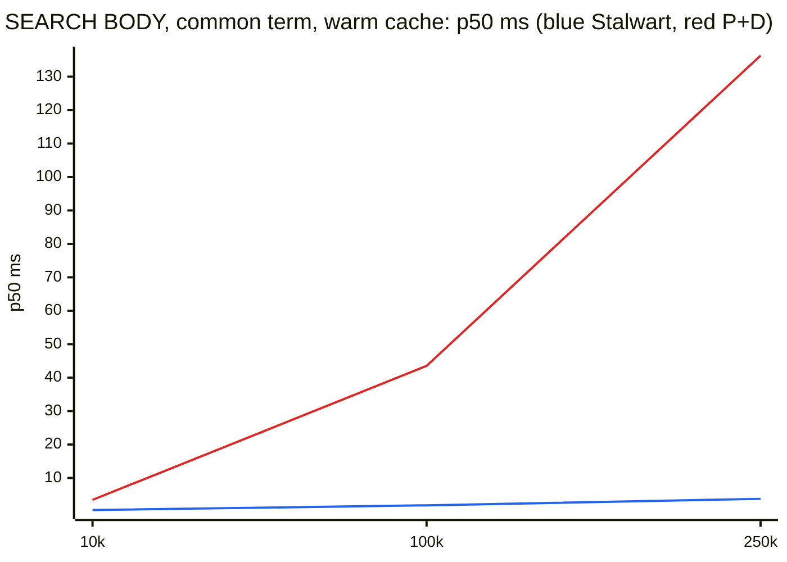
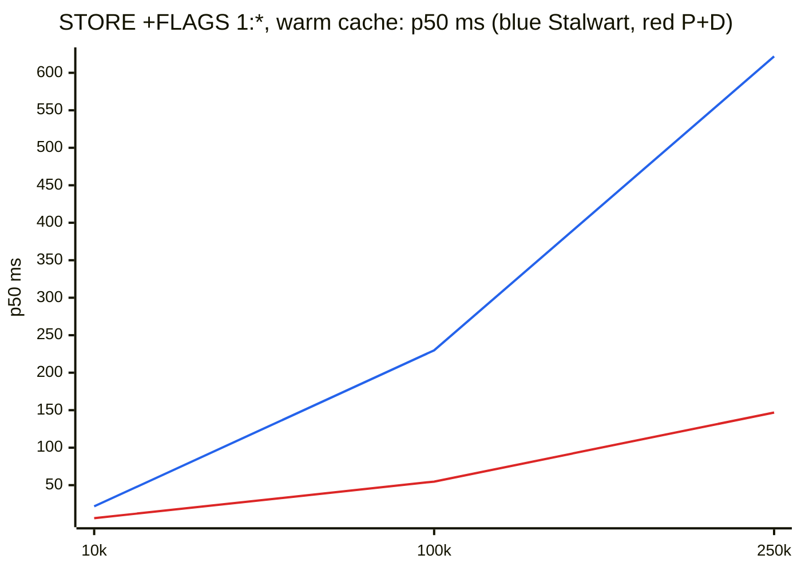
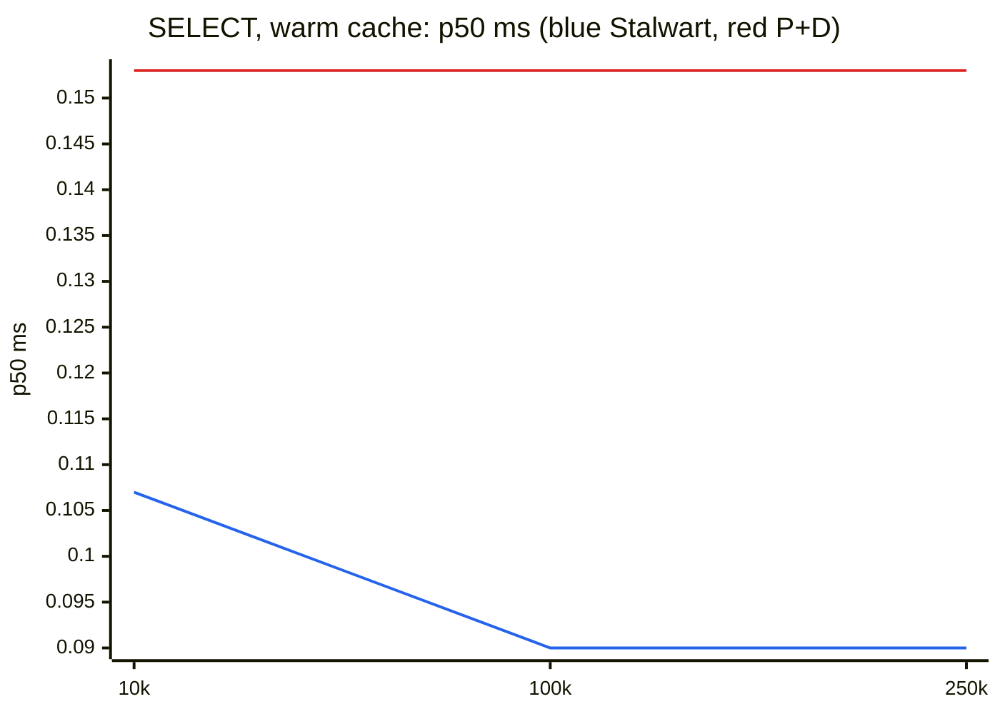

# Results

Part of the Stalwart vs Postfix and Dovecot comparison. Start at the [README](../README.md).

## Headline cells

Latencies are the median over repetitions of each repetition's p50 and p99, in milliseconds. "P+D / Stalwart p50" above 1 means Stalwart has the lower latency; below 1 means Postfix + Dovecot has. Cold-cache rows show the median and the maximum of the cold samples instead (one cold sample per repetition, [section 13](#13-large-mailboxes-cold-cache)). Throughput is the highest open-loop rate that met the SLO; "Stalwart / P+D" above 1 means Stalwart sustained more.

<!-- readme:headline:begin -->
| Test | Pair | Stalwart p50 / p99 ms | P+D p50 / p99 ms | P+D fsync=always p50 / p99 ms | P+D / Stalwart p50 | P+D / Stalwart p50, quickack client |
|---|---|---|---|---|---|---|
| C1 SMTP inbound, 4 KB, 1 session, 1 recipient (connect to 250) | c1 | 3.84 / 20.9 | 45.0 / 61.0 | 44.9 / 61.9 | 11.7x | 1.5x |
| C1 SMTP inbound, corpus mix, 16 sessions, 10 recipients | c10 | 7.97 / 31.2 | 75.3 / 206 | 77.0 / 169 | 9.5x | 3.7x |
| C2 connect to visible in INBOX, 4 KB, 1 session | c2 | 3.00 / 16.5 | 46.9 / 58.1 | 47.7 / 58.8 | 15.6x | 2.3x |
| C2 connect to visible in INBOX, mix, 16 sessions, 10 rcpts | c18 | 49.0 / 223 | 316 / 967 | 357 / 2,241 | 6.5x | 3.7x |
| C4 submission on 465 with AUTH, 4 KB, 1 session | c3 | 3.94 / 14.7 | 44.0 / 52.0 | n/a | 11.1x | 1.5x |
| C5 submission to accepted by the sink, 4 KB, 1 session | c1 | 16.0 / 56.2 | 57.4 / 101 | n/a | 3.6x | 1.0x |
| C7 IMAP connect, TLS, LOGIN, LOGOUT, 1 session | c3 | 3.31 / 13.6 | 7.15 / 18.6 | n/a | 2.2x |  |
| C10 FETCH 1:* (UID FLAGS), 1 session | c3 | 0.089 / 0.967 | 0.200 / 7.90 | n/a | 2.2x |  |
| C11 SEARCH BODY common term, 1 session | c9 | 0.133 / 0.274 | 0.222 / 1.40 | n/a | 1.7x |  |
| C12 SORT (DATE), 1 session | c8 | 0.091 / 0.263 | 0.300 / 2.38 | n/a | 3.3x |  |
| C16 APPEND 4 KB, 1 session | c6 | 0.238 / 0.484 | 0.333 / 0.580 | 0.747 / 1.25 | 1.4x |  |
| C16 APPEND 64 KB, 16 sessions | c8+c6 | 4.42 / 20.8 | 2.94 / 9.71 | 9.23 / 24.3 | 0.67x |  |
| FETCH 1:* (UID FLAGS) on 250k messages, warm | c5 | 20.5 / 27.7 | 179 / 1,335 | n/a | 8.7x |  |
| SEARCH BODY common term on 250k messages, warm | c5 | 3.75 / 5.51 | 136 / 494 | n/a | 36.4x |  |
| SORT (DATE) on 250k messages, warm | c6 | 21.8 / 23.5 | 184 / 217 | n/a | 8.4x |  |
| STORE +FLAGS 1:* on 250k messages, warm | c6 | 622 / 716 | 147 / 175 | n/a | 0.24x |  |
| FETCH 1:* (UID FLAGS) on 250k messages, cold | c8 | 21.7 / 24.5 | 173 / 215 | n/a | 8.0x |  |
| SORT (DATE) on 250k messages, cold | c8 | 29.6 / 30.4 | 208 / 216 | n/a | 7.0x |  |
| STORE +FLAGS 1:* on 250k messages, cold | c8 | 797 / 837 | 155 / 205 | n/a | 0.19x |  |

| Test | Pair | Stalwart rate at SLO | P+D rate at SLO | P+D fsync=always rate at SLO | Stalwart / P+D |
|---|---|---|---|---|---|
| C3 SMTP inbound, open loop, corpus mix (messages/s) | c19+c20 + c18 | 5,445/s | 723.1/s (repetition least favourable to Stalwart; median 263.5/s) | 188.2/s | 7.5x (median 20.7x) |
| C6 SMTP relay, open loop, corpus mix (messages/s) | c9 | 1,984/s | 516.5/s | n/a | 3.8x |
| C17 mixed IMAP sessions (session arrivals/s) | c6 + c26 | 2,178/s | 405.0/s | 405.0/s | 5.4x |

<!-- readme:headline:end -->

Large-mailbox scaling (p50 against mailbox size: 10k, 100k and 250k messages). Blue is Stalwart, red is Postfix + Dovecot. The axes are linear.

<!-- readme:charts:begin -->

<!-- readme:charts:end -->

How to read the tables:

- Repetitions per cell: 3 for most cells, 2 for large mailboxes with a warm cache, 10 one-sample repetitions for cold cells, and 1 for the IDLE cell (c02-idle).
- One row per cell and operation label. Latencies in milliseconds: the median over the valid repetitions of each repetition's p50, p95 and p99.
- "Pair" is the cluster (VM pair) the cell ran on.
- "Samples" is the number of timed operations summed over the valid repetitions. "Errors" is summed over all repetitions (bold when not zero). "CV" is the coefficient of variation of the per-repetition p50 (bold above 0.10).
- "(2/3 reps)" after a value means fewer valid repetitions than planned.
- Throughput tables show the highest ladder rate that met the SLO, as the median over repetitions and per repetition, with the worst p99 of the SLO labels at that rate.

Operation labels (where each timer starts and stops) are listed in [METHODOLOGY.md, section 4](METHODOLOGY.md#4-result-files).

## 1. C1: SMTP inbound latency

Port 25 with STARTTLS, one message per connection, from TCP connect to the 250 after DATA (`smtp`), and from MAIL FROM to that 250 (`smtp.message`). Sizes 4 KB, 64 KB, corpus mix and 1 MB; 1 or 16 sessions; 1 or 10 recipients.

<!-- readme:family:smtp-in:begin -->
| Cell | Pair | Operation | Stalwart p50 / p95 / p99 ms | P+D p50 / p95 / p99 ms | P+D fsync=always p50 / p95 / p99 ms | P+D / Stalwart p50 | P+D / Stalwart p50, quickack client | Samples Stalwart / P+D / P+D fsync=always | Errors Stalwart / P+D / P+D fsync=always | CV Stalwart / P+D / P+D fsync=always |
|---|---|---|---|---|---|---|---|---|---|---|
| c01-1m-sessions1-recipients1 | c1 | smtp | 6.05 / 17.6 / 29.0 | 47.8 / 58.7 / 131 | 47.8 / 58.3 / 68.7 | 7.9x | 1.5x | 3000 / 3000 / 3000 | 0 / 0 / 0 | 0.03 / 0.00 / 0.00 |
| c01-1m-sessions1-recipients1 | c1 | smtp.message | 1.98 / 3.42 / 5.69 | 3.89 / 5.62 / 85.8 | 3.96 / 5.70 / 8.70 | 2.0x |  | 3000 / 3000 / 3000 | 0 / 0 / 0 | 0.01 / 0.01 / 0.00 |
| c01-1m-sessions1-recipients10 | c1 | smtp | 6.44 / 17.4 / 27.2 | 50.2 / 124 / 239 | 49.4 / 60.2 / 78.7 | 7.8x | not measured | 3000 / 3000 / 3000 | 0 / 0 / 0 | 0.05 / 0.01 / 0.01 |
| c01-1m-sessions1-recipients10 | c1 | smtp.message | 1.89 / 3.61 / 6.71 | 5.26 / 51.7 / 149 | 5.17 / 6.98 / 29.2 | 2.8x |  | 3000 / 3000 / 3000 | 0 / 0 / 0 | 0.01 / 0.02 / 0.02 |
| c01-1m-sessions16-recipients1 | c1 | smtp | 17.5 / 237 / 561 | 64.2 / 89.6 / 145 | 72.1 / 107 / 146 | 3.7x | 2.4x | 3041 / 3045 / 3043 | 0 / 0 / 0 | 0.01 / 0.09 / 0.04 |
| c01-1m-sessions16-recipients1 | c1 | smtp.message | 11.5 / 230 / 419 | 15.1 / 39.0 / 81.4 | 18.6 / 49.5 / 61.2 | 1.3x |  | 3041 / 3045 / 3043 | 0 / 0 / 0 | 0.02 / **0.15** / 0.07 |
| c01-1m-sessions16-recipients10 | c1 | smtp | 23.3 / 351 / 2,535 | 161 / 310 / 699 | 125 / 201 / 268 | 6.9x | not measured | 3044 / 3044 / 3044 | 0 / 0 / 0 | 0.03 / 0.01 / 0.01 |
| c01-1m-sessions16-recipients10 | c1 | smtp.message | 16.2 / 228 / 348 | 50.5 / 112 / 148 | 45.4 / 92.2 / 116 | 3.1x |  | 3044 / 3044 / 3044 | 0 / 0 / 0 | **0.10** / 0.08 / 0.05 |
| c01-sessions1-recipients1-4k | c1 | smtp | 3.84 / 14.4 / 20.9 | 45.0 / 54.9 / 61.0 | 44.9 / 54.9 / 61.9 | 11.7x | 1.5x | 30000 / 30000 / 30000 | 0 / 0 / 0 | 0.06 / 0.00 / 0.00 |
| c01-sessions1-recipients1-4k | c1 | smtp.message | 0.327 / 0.597 / 1.33 | 0.930 / 1.38 / 3.60 | 0.939 / 1.20 / 3.59 | 2.8x |  | 30000 / 30000 / 30000 | 0 / 0 / 0 | 0.00 / 0.06 / 0.06 |
| c01-sessions1-recipients1-64k | c1 | smtp | 4.59 / 15.4 / 24.4 | 46.3 / 57.3 / 70.1 | 46.0 / 57.0 / 70.3 | 10.1x | not measured | 30000 / 30000 / 30000 | 0 / 0 / 0 | 0.01 / 0.01 / 0.00 |
| c01-sessions1-recipients1-64k | c1 | smtp.message | 0.735 / 2.12 / 3.88 | 1.48 / 1.76 / 10.3 | 1.43 / 1.67 / 15.8 | 2.0x |  | 30000 / 30000 / 30000 | 0 / 0 / 0 | 0.03 / 0.06 / 0.03 |
| c01-sessions1-recipients1-mix | c1 | smtp | 4.03 / 14.1 / 21.0 | 46.0 / 58.0 / 76.5 | 45.9 / 57.8 / 70.8 | 11.4x | not measured | 30000 / 30000 / 30000 | 0 / 0 / 0 | 0.01 / 0.00 / 0.00 |
| c01-sessions1-recipients1-mix | c1 | smtp.message | 0.388 / 1.11 / 2.63 | 1.06 / 1.51 / 25.1 | 0.867 / 1.30 / 18.9 | 2.7x |  | 30000 / 30000 / 30000 | 0 / 0 / 0 | 0.04 / 0.05 / 0.07 |
| c01-sessions1-recipients10-4k | c10 | smtp | 2.69 / 8.60 / 13.2 | 45.0 / 52.9 / 113 | 45.0 / 52.8 / 152 | 16.7x | not measured | 30000 / 30000 / 30000 | 0 / 0 / 0 | 0.01 / 0.00 / 0.00 |
| c01-sessions1-recipients10-4k | c10 | smtp.message | 0.349 / 1.17 / 2.29 | 1.76 / 1.91 / 55.8 | 1.71 / 1.85 / 99.3 | 5.0x |  | 30000 / 30000 / 30000 | 0 / 0 / 0 | 0.01 / 0.00 / 0.00 |
| c01-sessions1-recipients10-64k | c11 | smtp | 6.04 / 18.9 / 25.2 | 69.7 / 288 / 449 | 91.6 / 308 / 389 | 11.5x | not measured | 30000 / 30000 / 30000 | 0 / 0 / 0 | 0.01 / 0.01 / **0.22** |
| c01-sessions1-recipients10-64k | c11 | smtp.message | 0.835 / 3.01 / 5.77 | 18.3 / 189 / 308 | 32.6 / 216 / 289 | 21.9x |  | 30000 / 30000 / 30000 | 0 / 0 / 0 | 0.00 / 0.09 / **0.50** |
| c01-sessions1-recipients10-mix | c1 | smtp | 5.04 / 15.8 / 23.7 | 48.0 / 138 / 169 | 48.8 / 128 / 149 | 9.5x | not measured | 30000 / 30000 / 30000 | 0 / 0 / 0 | 0.02 / 0.00 / 0.01 |
| c01-sessions1-recipients10-mix | c1 | smtp.message | 0.657 / 3.10 / 5.38 | 2.17 / 69.3 / 98.4 | 2.04 / 59.7 / 81.5 | 3.3x |  | 30000 / 30000 / 30000 | 0 / 0 / 0 | 0.06 / 0.05 / 0.01 |
| c01-sessions16-recipients1-4k | c11 | smtp | 2.71 / 14.7 / 23.3 | 60.4 / 103 / 129 | 53.7 / 179 / 219 | 22.3x | 4.1x | 30044 / 30043 / 30041 | 0 / 0 / 0 | 0.02 / 0.01 / 0.01 |
| c01-sessions16-recipients1-4k | c11 | smtp.message | 0.618 / 5.28 / 9.05 | 7.59 / 27.5 / 30.4 | 3.79 / 40.0 / 49.8 | 12.3x |  | 30044 / 30043 / 30041 | 0 / 0 / 0 | 0.03 / **0.11** / 0.10 |
| c01-sessions16-recipients1-64k | c11 | smtp | 3.97 / 15.9 / 24.2 | 88.4 / 349 / 475 | 89.2 / 397 / 816 | 22.3x | not measured | 30045 / 30044 / 30045 | 0 / 0 / 0 | 0.01 / 0.06 / 0.05 |
| c01-sessions16-recipients1-64k | c11 | smtp.message | 1.37 / 7.04 / 13.9 | 18.4 / 108 / 161 | 18.2 / 118 / 199 | 13.5x |  | 30045 / 30044 / 30045 | 0 / 0 / 0 | 0.04 / 0.05 / **0.11** |
| c01-sessions16-recipients1-mix | c11 | smtp | 3.80 / 14.4 / 20.6 | 63.9 / 269 / 378 | 61.9 / 289 / 390 | 16.8x | not measured | 30042 / 30045 / 30043 | 0 / 0 / 0 | 0.07 / 0.02 / 0.02 |
| c01-sessions16-recipients1-mix | c11 | smtp.message | 1.06 / 5.84 / 9.66 | 8.71 / 59.8 / 80.1 | 8.51 / 59.4 / 79.7 | 8.2x |  | 30042 / 30045 / 30043 | 0 / 0 / 0 | 0.08 / 0.02 / 0.06 |
| c01-sessions16-recipients10-4k | c10 | smtp | 11.9 / 20.8 / 27.6 | 64.6 / 94.7 / 601 | 68.4 / 418 / 1,150 | 5.4x | not measured | 30042 / 30044 / 30045 | 0 / 0 / 0 | 0.02 / 0.00 / 0.01 |
| c01-sessions16-recipients10-4k | c10 | smtp.message | 7.83 / 13.2 / 18.8 | 14.7 / 40.0 / 248 | 16.7 / 149 / 189 | 1.9x |  | 30042 / 30044 / 30045 | 0 / 0 / 0 | 0.03 / 0.03 / 0.03 |
| c01-sessions16-recipients10-64k | c10 | smtp | 14.6 / 27.0 / 37.3 | 80.6 / 141 / 232 | 74.1 / 125 / 197 | 5.5x | not measured | 30042 / 30042 / 30045 | 0 / 0 / 0 | 0.02 / 0.03 / 0.00 |
| c01-sessions16-recipients10-64k | c10 | smtp.message | 10.1 / 20.0 / 29.5 | 28.0 / 72.3 / 132 | 23.5 / 59.6 / 86.0 | 2.8x |  | 30042 / 30042 / 30045 | 0 / 0 / 0 | 0.02 / 0.06 / 0.02 |
| c01-sessions16-recipients10-mix | c10 | smtp | 7.97 / 21.6 / 31.2 | 75.3 / 148 / 206 | 77.0 / 126 / 169 | 9.5x | 3.7x | 30043 / 30045 / 30044 | 0 / 0 / 0 | **0.11** / 0.01 / 0.06 |
| c01-sessions16-recipients10-mix | c10 | smtp.message | 4.67 / 15.8 / 24.1 | 21.5 / 56.9 / 91.5 | 20.3 / 41.4 / 56.9 | 4.6x |  | 30043 / 30045 / 30044 | 0 / 0 / 0 | **0.14** / 0.01 / 0.03 |

The cells of this family ran on clusters c1, c10 and c11 (column Pair). Within a cell, both systems and all repetitions share one VM pair.

<!-- readme:family:smtp-in:end -->

Stalwart's p99 tails in the 1 MB write tests (SMTP 1 MB and APPEND 1 MB with 16 sessions) come from storage: with the default storage, each message blob is written to disk twice (the RocksDB write-ahead log and the blob file), so at high 1 MB write rates the server's disk bandwidth limits it and RocksDB briefly throttles writes. Storing blobs on the filesystem instead avoids this.

How to read C1: `smtp` is the whole connection (TCP connect, greeting, EHLO, STARTTLS with a full TLS 1.3 handshake, second EHLO, one message; QUIT not included), `smtp.message` only the message transaction (MAIL FROM to the 250 after DATA). `smtp.message` is the closer comparison of the work done per message, and includes Postfix's queue file fsync ([FAIRNESS.md, section 1.1](FAIRNESS.md#11-durability-this-favours-stalwart)). With 16 sessions both systems queue work, and the 1 MB cells add the transfer of the message itself. The `fsync=always` column changes only Dovecot's delivery, which happens after the 250, so it barely moves C1. The per-phase histograms (connect, greeting, tls, command) are in every result file under `ops.smtp.phases`.

### Postfix's 40 ms stall after the TLS handshake

On about 73% of Postfix TLS connections (in a packet-capture diagnostic on one cluster, [results/c-probe-check/tls-stall/c20/](../results/c-probe-check/tls-stall/c20/)), the first reply after the handshake (the EHLO reply after STARTTLS on port 25, the 220 greeting on port 465) arrives about 40 ms late. On one session it is most of Postfix's connect-to-250 time: for the 4 KB cell on c1 the STARTTLS phase has a p50 of about 42 ms on Postfix against about 0.5 ms on Stalwart, while the message transaction takes about 1 ms. Single connections without the stall exist, so it is a timing interaction, not a fixed delay.

The cause, verified in the Postfix 3.11.7 and OpenSSL 3.0.13 sources:

1. OpenSSL writes the TLS 1.3 NewSessionTicket as its own record and flushes it right after the handshake, and Postfix enables one ticket whenever TLS session caching is on. Turning tickets off in Postfix does not help, because OpenSSL then sends two stateful tickets instead.
2. Postfix never sets `TCP_NODELAY` on its smtpd sockets, by design (Postfix HISTORY, 2019-08-25: "Postfix won't turn on client-side TCP_NODELAY because that hides application performance bugs"), and no setting controls it.
3. So Postfix sends two small segments back to back: the ticket, then the reply. Nagle's algorithm holds the reply until the client acknowledges the ticket, and the client, which has nothing to send while it waits for the reply, acknowledges on its delayed-ACK timer: 40 ms on Linux.

It is not configurable on the Postfix side. Whether a client pays the 40 ms depends on its TCP stack: any client with delayed ACKs (the Linux default, also used by Postfix's own SMTP client and most MTA clients) that sends nothing between the handshake and the server's first reply, which is the normal SMTP flow, sees it; a client that acknowledges immediately (`TCP_QUICKACK`) would not. A packet capture on a load host confirmed the first half: after the client's Finished, both servers send the session ticket as a separate small segment, and the client acknowledges it only after 40 to 41 ms. Our load generator sets `TCP_NODELAY` on its own sockets, never `TCP_QUICKACK`, and treats both servers identically; `TCP_NODELAY` affects only what the client sends. Stalwart sets `TCP_NODELAY` on accepted sockets, and Dovecot's IMAP (C7 to C17) does not stall either. The cost is a fixed ~40 ms per TLS connection: on this 65 us LAN it dominates, over the Internet it is a smaller share of each connection.

The measurement keeps it, because it is what such clients get: every factor in this report is end to end. The SMTP latency tables (C1, C2 including c02-idle, C4 and C5, and the headline table) have a column "quickack client" for diagnostic runs of the same cells with a load generator that acknowledges immediately, which removes the stall; it shows "not measured" for cells that were not repeated this way. These runs are a diagnostic, not the result: our load generator, like Postfix's own SMTP client, does not set `TCP_QUICKACK`. For them, routes with `quickack 1` were added on the load hosts only (servers untouched), covering all load-host traffic to both servers, SMTP and the IMAP probe alike; the relay leg from the server to the sink in C5 is not covered. They ran on other clusters than the end-to-end cells, so their factor compares the two systems on one VM pair, but their absolute values come from a different pair. Results: `results/c-quickack/`.

## 2. C2: SMTP to INBOX delivery latency

From TCP connect of the sending session until the message is visible in every recipient's INBOX (`smtp.delivery`). Rows `smtp` and `smtp.message` are the SMTP part of the same samples.

How visibility is detected (`probe: imap_poll`): every recipient has one IMAP connection with INBOX selected. The probe is armed before the sender's TCP connect and issues NOOPs back to back on each recipient connection (no pause between them) until EXISTS grows; the sample ends when that NOOP's reply arrives. The resolution of the measurement is the NOOP round trip of the deciding probe, published per server as `smtp.probe_rtt` in the same table. A delivery latency is only as sharp as that row: under load Dovecot answers NOOP more slowly than Stalwart, which widens its delivery numbers by up to one probe round trip.

A probe check (16 sessions, 10 recipients, 300 samples, one repetition, `results/c-probe-check/`) compares NOOP polling with STATUS polling on a second connection. STATUS does not sharpen Dovecot's resolution: at 4 KB the Dovecot probe p95 is 30.8 ms with NOOP and 533 ms with STATUS, at 1 MB 232 ms with NOOP and 37 ms with STATUS, with no change in the delivery p50 that would alter the comparison. C2 therefore uses NOOP polling:

<!-- readme:probe:begin -->
| Size | Probe | System | Delivery p50 / p95 / p99 ms | Probe RTT p50 / p95 / p99 ms | Samples |
|---|---|---|---|---|---|
| 4K | NOOP poll | Stalwart | 36.6 / 56.2 / 68.6 | 1.39 / 6.60 / 11.8 | 308 |
| 4K | NOOP poll | P+D | 202 / 394 / 551 | 9.66 / 30.8 / 331 | 314 |
| 4K | STATUS poll | Stalwart | 38.2 / 65.3 / 72.3 | 1.39 / 6.24 / 9.98 | 312 |
| 4K | STATUS poll | P+D | 244 / 1,226 / 1,695 | 7.77 / 533 / 1,548 | 306 |
| 1M | NOOP poll | Stalwart | 72.9 / 121 / 145 | 2.11 / 14.1 / 107 | 302 |
| 1M | NOOP poll | P+D | 581 / 1,294 / 2,230 | 5.75 / 232 / 1,839 | 301 |
| 1M | STATUS poll | Stalwart | 82.8 / 226 / 279 | 1.64 / 8.95 / 50.8 | 304 |
| 1M | STATUS poll | P+D | 545 / 1,068 / 1,119 | 5.39 / 37.3 / 842 | 302 |

<!-- readme:probe:end -->

**c02-idle (push notification latency).** One cell (4 KB, 1 session, 1 recipient, 500 samples, one repetition) uses IMAP IDLE instead of polling and measures when the server pushes the new message. Dovecot delays IDLE notifications on purpose: `src/lib-storage/mailbox-watch.c` defines `NOTIFY_DELAY_MSECS 500`, and mailbox changes are reported after that delay, so about 500 ms of its c02-idle latency is this constant and not delivery work. The cell is published for completeness; the polling cells are the delivery comparison.

<!-- readme:family:delivery:begin -->
| Cell | Pair | Operation | Stalwart p50 / p95 / p99 ms | P+D p50 / p95 / p99 ms | P+D fsync=always p50 / p95 / p99 ms | P+D / Stalwart p50 | P+D / Stalwart p50, quickack client | Samples Stalwart / P+D / P+D fsync=always | Errors Stalwart / P+D / P+D fsync=always | CV Stalwart / P+D / P+D fsync=always |
|---|---|---|---|---|---|---|---|---|---|---|
| c02-1m-sessions1-recipients1 | c2 | smtp | 4.34 / 12.7 / 17.6 | 46.7 / 54.9 / 57.5 | 46.8 / 55.3 / 58.6 | 10.8x | not measured | 3000 / 3000 / 3000 | 0 / 0 / 0 | 0.03 / 0.00 / 0.00 |
| c02-1m-sessions1-recipients1 | c2 | smtp.message | 1.66 / 2.75 / 3.44 | 3.80 / 4.66 / 5.88 | 3.81 / 4.75 / 5.98 | 2.3x |  | 3000 / 3000 / 3000 | 0 / 0 / 0 | 0.02 / 0.00 / 0.00 |
| c02-1m-sessions1-recipients1 | c2 | smtp.delivery | 4.82 / 13.2 / 18.0 | 53.4 / 61.5 / 65.2 | 53.8 / 62.3 / 66.5 | 11.1x | not measured | 3000 / 3000 / 3000 | 0 / 0 / 0 | 0.02 / 0.00 / 0.00 |
| c02-1m-sessions1-recipients1 | c2 | smtp.probe_rtt | 0.140 / 0.180 / 0.224 | 0.251 / 0.385 / 0.713 | 0.249 / 0.457 / 0.778 | 1.8x |  | 3000 / 3000 / 3000 | 0 / 0 / 0 | 0.02 / 0.00 / 0.01 |
| c02-1m-sessions1-recipients10 | c2 | smtp | 5.55 / 13.1 / 17.6 | 50.5 / 59.3 / 394 | 51.3 / 58.1 / 76.9 | 9.1x | not measured | 3000 / 3000 / 3000 | 0 / 0 / 0 | 0.01 / 0.02 / 0.00 |
| c02-1m-sessions1-recipients10 | c2 | smtp.message | 2.81 / 4.78 / 6.71 | 5.79 / 8.04 / 259 | 6.70 / 8.20 / 10.5 | 2.1x |  | 3000 / 3000 / 3000 | 0 / 0 / 0 | 0.07 / 0.09 / 0.02 |
| c02-1m-sessions1-recipients10 | c2 | smtp.delivery | 8.23 / 17.1 / 830 | 85.6 / 255 / 897 | 102 / 567 / 1,990 | 10.4x | not measured | 3000 / 3000 / 3000 | 0 / 0 / 0 | 0.00 / 0.03 / 0.02 |
| c02-1m-sessions1-recipients10 | c2 | smtp.probe_rtt | 0.130 / 1.57 / 3.60 | 0.186 / 0.804 / 2.35 | 0.287 / 1.26 / 4.10 | 1.4x |  | 3000 / 3000 / 3000 | 0 / 0 / 0 | 0.04 / 0.01 / 0.01 |
| c02-1m-sessions16-recipients1 | c2 | smtp | 14.9 / 235 / 825 | 74.2 / 270 / 1,467 | 71.4 / 123 / 1,222 | 5.0x | not measured | 3035 / 3031 / 3035 | 0 / 0 / 0 | 0.07 / 0.00 / 0.01 |
| c02-1m-sessions16-recipients1 | c2 | smtp.message | 9.93 / 180 / 335 | 24.3 / 67.1 / 281 | 21.6 / 64.5 / 195 | 2.4x |  | 3035 / 3031 / 3035 | 0 / 0 / 0 | **0.11** / 0.02 / 0.03 |
| c02-1m-sessions16-recipients1 | c2 | smtp.delivery | 18.3 / 275 / 759 | 107 / 308 / 1,400 | 104 / 175 / 1,295 | 5.8x | not measured | 3035 / 3031 / 3035 | 0 / 0 / 0 | 0.08 / 0.02 / 0.02 |
| c02-1m-sessions16-recipients1 | c2 | smtp.probe_rtt | 0.440 / 2.00 / 3.77 | 0.805 / 5.38 / 10.3 | 1.86 / 7.59 / 11.6 | 1.8x |  | 3035 / 3031 / 3035 | 0 / 0 / 0 | 0.10 / 0.02 / 0.06 |
| c02-1m-sessions16-recipients10 | c2 | smtp | 24.9 / 84.9 / 219 | 140 / 1,383 / 2,204 | 125 / 205 / 309 | 5.6x | not measured | 3023 / 3021 / 3009 | 0 / 0 / 0 | 0.01 / 0.02 / 0.03 |
| c02-1m-sessions16-recipients10 | c2 | smtp.message | 16.6 / 40.7 / 162 | 78.4 / 353 / 459 | 70.3 / 134 / 172 | 4.7x |  | 3023 / 3021 / 3009 | 0 / 0 / 0 | 0.01 / 0.01 / 0.05 |
| c02-1m-sessions16-recipients10 | c2 | smtp.delivery | 55.3 / 297 / 1,010 | 415 / 1,715 / 2,400 | 507 / 845 / 1,198 | 7.5x | not measured | 3023 / 3021 / 3009 | 0 / 0 / 0 | 0.03 / 0.03 / 0.02 |
| c02-1m-sessions16-recipients10 | c2 | smtp.probe_rtt | 1.41 / 8.88 / 151 | 7.17 / 23.0 / 502 | 6.51 / 25.6 / 345 | 5.1x |  | 3023 / 3021 / 3009 | 0 / 0 / 0 | 0.03 / 0.06 / 0.02 |
| c02-idle-sessions1-recipients1-4k | c2 | smtp | 2.97 / 13.5 / 17.6 | 43.7 / 50.7 / 54.8 | 43.7 / 49.9 / 54.4 | 14.7x | 0.88x | 500 / 133 / 134 | 0 / 0 / 0 | - / - / - |
| c02-idle-sessions1-recipients1-4k | c2 | smtp.message | 0.279 / 0.309 / 0.363 | 0.764 / 0.950 / 3.48 | 0.757 / 0.941 / 3.19 | 2.7x |  | 500 / 133 / 134 | 0 / 0 / 0 | - / - / - |
| c02-idle-sessions1-recipients1-4k | c2 | smtp.delivery | 3.31 / 14.3 / 17.9 | 501 / 30,032 / 30,032 | 501 / 30,032 / 30,032 | 151.4x | 130.8x | 500 / 133 / 134 | 0 / 0 / 0 | - / - / - |
| c02-sessions1-recipients1-4k | c2 | smtp | 2.73 / 12.7 / 16.2 | 43.4 / 49.4 / 54.4 | 43.5 / 49.0 / 54.3 | 15.9x | 1.3x | 30000 / 30000 / 30000 | 0 / 0 / 0 | 0.05 / 0.00 / 0.00 |
| c02-sessions1-recipients1-4k | c2 | smtp.message | 0.290 / 0.325 / 0.370 | 0.756 / 0.828 / 3.06 | 0.744 / 0.807 / 3.04 | 2.6x |  | 30000 / 30000 / 30000 | 0 / 0 / 0 | 0.00 / 0.00 / 0.01 |
| c02-sessions1-recipients1-4k | c2 | smtp.delivery | 3.00 / 13.0 / 16.5 | 46.9 / 53.2 / 58.1 | 47.7 / 53.8 / 58.8 | 15.6x | 2.3x | 30000 / 30000 / 30000 | 0 / 0 / 0 | 0.05 / 0.01 / 0.01 |
| c02-sessions1-recipients1-4k | c2 | smtp.probe_rtt | 0.127 / 0.146 / 0.165 | 0.154 / 0.437 / 0.723 | 0.252 / 0.905 / 1.16 | 1.2x |  | 30000 / 30000 / 30000 | 0 / 0 / 0 | 0.00 / 0.01 / 0.01 |
| c02-sessions1-recipients1-64k | c2 | smtp | 2.98 / 13.5 / 17.1 | 43.7 / 50.9 / 55.4 | 43.8 / 52.7 / 57.8 | 14.7x | not measured | 30000 / 30000 / 30000 | 0 / 0 / 0 | 0.01 / 0.00 / 0.00 |
| c02-sessions1-recipients1-64k | c2 | smtp.message | 0.571 / 0.787 / 1.04 | 1.04 / 1.15 / 3.50 | 1.05 / 1.14 / 3.49 | 1.8x |  | 30000 / 30000 / 30000 | 0 / 0 / 0 | 0.01 / 0.00 / 0.00 |
| c02-sessions1-recipients1-64k | c2 | smtp.delivery | 3.31 / 13.8 / 17.4 | 47.8 / 55.1 / 59.2 | 49.0 / 57.9 / 62.9 | 14.4x | not measured | 30000 / 30000 / 30000 | 0 / 0 / 0 | 0.01 / 0.00 / 0.01 |
| c02-sessions1-recipients1-64k | c2 | smtp.probe_rtt | 0.131 / 0.154 / 0.214 | 0.155 / 0.576 / 0.861 | 0.254 / 1.25 / 1.43 | 1.2x |  | 30000 / 30000 / 30000 | 0 / 0 / 0 | 0.02 / 0.00 / 0.00 |
| c02-sessions1-recipients1-mix | c2 | smtp | 3.31 / 13.0 / 16.9 | 43.6 / 53.1 / 57.6 | 43.5 / 53.6 / 57.0 | 13.1x | not measured | 30000 / 30000 / 30000 | 0 / 0 / 0 | 0.02 / 0.00 / 0.00 |
| c02-sessions1-recipients1-mix | c2 | smtp.message | 0.325 / 0.530 / 1.02 | 0.797 / 0.952 / 3.40 | 0.789 / 0.943 / 3.36 | 2.5x |  | 30000 / 30000 / 30000 | 0 / 0 / 0 | 0.00 / 0.01 / 0.01 |
| c02-sessions1-recipients1-mix | c2 | smtp.delivery | 3.61 / 13.3 / 17.1 | 49.0 / 58.6 / 63.0 | 50.1 / 60.9 / 64.7 | 13.6x | not measured | 30000 / 30000 / 30000 | 0 / 0 / 0 | 0.02 / 0.00 / 0.00 |
| c02-sessions1-recipients1-mix | c2 | smtp.probe_rtt | 0.132 / 0.156 / 0.267 | 0.156 / 1.57 / 1.69 | 0.252 / 2.24 / 9.86 | 1.2x |  | 30000 / 30000 / 30000 | 0 / 0 / 0 | 0.00 / 0.00 / 0.00 |
| c02-sessions1-recipients10-4k | c2 | smtp | 3.09 / 13.2 / 16.8 | 47.3 / 54.3 / 58.4 | 46.7 / 51.6 / 56.6 | 15.3x | not measured | 30000 / 30000 / 30000 | 0 / 0 / 0 | 0.02 / 0.00 / 0.01 |
| c02-sessions1-recipients10-4k | c2 | smtp.message | 0.458 / 1.33 / 2.65 | 2.40 / 2.70 / 5.69 | 2.38 / 2.75 / 5.74 | 5.2x |  | 30000 / 30000 / 30000 | 0 / 0 / 0 | 0.01 / 0.07 / **0.11** |
| c02-sessions1-recipients10-4k | c2 | smtp.delivery | 4.75 / 15.5 / 760 | 82.5 / 101 / 992 | 95.6 / 124 / 1,021 | 17.4x | not measured | 30000 / 30000 / 30000 | 0 / 0 / 0 | 0.02 / 0.03 / 0.04 |
| c02-sessions1-recipients10-4k | c2 | smtp.probe_rtt | 0.122 / 1.39 / 3.38 | 0.209 / 2.22 / 3.98 | 0.291 / 1.48 / 3.95 | 1.7x |  | 30000 / 30000 / 30000 | 0 / 0 / 0 | 0.01 / 0.07 / 0.01 |
| c02-sessions1-recipients10-64k | c13 | smtp | 6.54 / 18.2 / 25.1 | 55.2 / 68.5 / 165 | 53.3 / 64.7 / 73.2 | 8.4x | not measured | 30000 / 30000 / 30000 | 0 / 0 / 0 | 0.01 / 0.00 / 0.00 |
| c02-sessions1-recipients10-64k | c13 | smtp.message | 1.20 / 3.73 / 5.39 | 4.67 / 10.5 / 83.3 | 3.50 / 8.15 / 10.8 | 3.9x |  | 30000 / 30000 / 30000 | 0 / 0 / 0 | 0.02 / 0.01 / 0.04 |
| c02-sessions1-recipients10-64k | c13 | smtp.delivery | 9.69 / 21.9 / 29.1 | 95.6 / 113 / 285 | 113 / 130 / 145 | 9.9x | not measured | 30000 / 30000 / 30000 | 0 / 0 / 0 | 0.01 / 0.04 / 0.03 |
| c02-sessions1-recipients10-64k | c13 | smtp.probe_rtt | 1.08 / 3.81 / 5.68 | 0.283 / 3.49 / 4.97 | 0.614 / 4.60 / 6.66 | 0.26x |  | 30000 / 30000 / 30000 | 0 / 0 / 0 | 0.02 / 0.02 / 0.07 |
| c02-sessions1-recipients10-mix | c13 | smtp | 6.95 / 19.1 / 26.0 | 50.1 / 61.6 / 72.1 | 49.8 / 61.2 / 69.3 | 7.2x | not measured | 30000 / 30000 / 30000 | 0 / 0 / 0 | 0.03 / 0.01 / 0.01 |
| c02-sessions1-recipients10-mix | c13 | smtp.message | 1.04 / 4.53 / 7.54 | 2.66 / 3.14 / 6.76 | 2.77 / 3.46 / 7.01 | 2.6x |  | 30000 / 30000 / 30000 | 0 / 0 / 0 | 0.02 / 0.07 / 0.08 |
| c02-sessions1-recipients10-mix | c13 | smtp.delivery | 10.8 / 24.7 / 33.3 | 94.1 / 109 / 123 | 110 / 130 / 184 | 8.7x | not measured | 30000 / 30000 / 30000 | 0 / 0 / 0 | 0.03 / 0.03 / 0.02 |
| c02-sessions1-recipients10-mix | c13 | smtp.probe_rtt | 1.17 / 4.74 / 7.36 | 0.192 / 1.28 / 2.94 | 0.316 / 2.23 / 5.35 | 0.16x |  | 30000 / 30000 / 30000 | 0 / 0 / 0 | 0.05 / 0.02 / 0.01 |
| c02-sessions16-recipients1-4k | c13 | smtp | 5.76 / 20.3 / 60.4 | 56.9 / 72.6 / 84.9 | 58.2 / 76.2 / 87.0 | 9.9x | not measured | 30041 / 30042 / 30039 | 0 / 0 / 0 | 0.03 / 0.01 / 0.01 |
| c02-sessions16-recipients1-4k | c13 | smtp.message | 1.32 / 7.83 / 13.3 | 4.94 / 13.8 / 20.3 | 5.72 / 16.4 / 24.6 | 3.7x |  | 30041 / 30042 / 30039 | 0 / 0 / 0 | 0.05 / 0.04 / 0.03 |
| c02-sessions16-recipients1-4k | c13 | smtp.delivery | 7.39 / 24.6 / 71.9 | 75.4 / 102 / 122 | 81.1 / 114 / 135 | 10.2x | not measured | 30041 / 30042 / 30039 | 0 / 0 / 0 | 0.03 / 0.01 / 0.02 |
| c02-sessions16-recipients1-4k | c13 | smtp.probe_rtt | 0.376 / 2.27 / 4.53 | 0.934 / 7.03 / 12.3 | 1.96 / 8.61 / 14.2 | 2.5x |  | 30041 / 30042 / 30039 | 0 / 0 / 0 | 0.02 / 0.01 / 0.01 |
| c02-sessions16-recipients1-64k | c13 | smtp | 10.8 / 24.9 / 37.1 | 59.7 / 79.3 / 198 | 61.2 / 80.8 / 95.6 | 5.6x | not measured | 30028 / 30039 / 30036 | 0 / 0 / 0 | 0.03 / 0.00 / 0.00 |
| c02-sessions16-recipients1-64k | c13 | smtp.message | 4.69 / 13.9 / 21.0 | 7.38 / 18.9 / 69.4 | 8.26 / 20.9 / 31.2 | 1.6x |  | 30028 / 30039 / 30036 | 0 / 0 / 0 | 0.09 / 0.01 / 0.03 |
| c02-sessions16-recipients1-64k | c13 | smtp.delivery | 14.7 / 31.5 / 45.7 | 83.8 / 118 / 217 | 92.0 / 129 / 158 | 5.7x | not measured | 30028 / 30039 / 30036 | 0 / 0 / 0 | 0.03 / 0.00 / 0.00 |
| c02-sessions16-recipients1-64k | c13 | smtp.probe_rtt | 0.862 / 4.79 / 7.98 | 1.11 / 8.78 / 17.3 | 2.41 / 11.2 / 19.0 | 1.3x |  | 30028 / 30039 / 30036 | 0 / 0 / 0 | 0.03 / 0.02 / 0.04 |
| c02-sessions16-recipients1-mix | c13 | smtp | 9.59 / 22.7 / 32.3 | 57.3 / 75.1 / 119 | 58.1 / 76.4 / 91.3 | 6.0x | not measured | 30030 / 30036 / 30031 | 0 / 0 / 0 | 0.03 / 0.00 / 0.01 |
| c02-sessions16-recipients1-mix | c13 | smtp.message | 3.86 / 12.5 / 18.9 | 5.21 / 15.4 / 35.1 | 5.40 / 16.9 / 29.2 | 1.4x |  | 30030 / 30036 / 30031 | 0 / 0 / 0 | 0.03 / 0.02 / 0.06 |
| c02-sessions16-recipients1-mix | c13 | smtp.delivery | 13.2 / 29.5 / 41.2 | 77.4 / 107 / 148 | 81.8 / 115 / 143 | 5.9x | not measured | 30030 / 30036 / 30031 | 0 / 0 / 0 | 0.03 / 0.00 / 0.02 |
| c02-sessions16-recipients1-mix | c13 | smtp.probe_rtt | 0.720 / 4.83 / 8.64 | 1.04 / 8.38 / 16.2 | 2.08 / 9.51 / 14.9 | 1.4x |  | 30030 / 30036 / 30031 | 0 / 0 / 0 | 0.04 / 0.02 / 0.02 |
| c02-sessions16-recipients10-4k | c18 | smtp | 14.2 / 25.9 / 34.8 | 73.2 / 100 / 332 | 75.6 / 106 / 189 | 5.2x | not measured | 30031 / 30020 / 30023 | 0 / 0 / 0 | 0.01 / 0.01 / 0.01 |
| c02-sessions16-recipients10-4k | c18 | smtp.message | 6.18 / 14.2 / 18.5 | 20.2 / 41.4 / 82.0 | 22.5 / 46.9 / 107 | 3.3x |  | 30031 / 30020 / 30023 | 0 / 0 / 0 | 0.03 / 0.02 / 0.04 |
| c02-sessions16-recipients10-4k | c18 | smtp.delivery | 36.2 / 62.9 / 169 | 190 / 303 / 682 | 285 / 545 / 2,034 | 5.2x | not measured | 30031 / 30020 / 30023 | 0 / 0 / 0 | 0.02 / 0.05 / 0.03 |
| c02-sessions16-recipients10-4k | c18 | smtp.probe_rtt | 1.67 / 6.82 / 12.3 | 10.5 / 24.9 / 34.4 | 8.57 / 29.4 / 42.8 | 6.2x |  | 30031 / 30020 / 30023 | 0 / 0 / 0 | 0.06 / 0.04 / 0.08 |
| c02-sessions16-recipients10-64k | c18 | smtp | 18.2 / 32.4 / 42.4 | 73.1 / 168 / 508 | 77.5 / 106 / 135 | 4.0x | not measured | 30015 / 30015 / 23943 | 0 / 0 / 0 | 0.01 / 0.01 / **0.80** |
| c02-sessions16-recipients10-64k | c18 | smtp.message | 9.61 / 20.5 / 27.1 | 20.9 / 50.7 / 211 | 24.9 / 47.6 / 66.9 | 2.2x |  | 30015 / 30015 / 23943 | 0 / 0 / 0 | 0.01 / 0.01 / **0.83** |
| c02-sessions16-recipients10-64k | c18 | smtp.delivery | 44.5 / 77.6 / 175 | 270 / 409 / 824 | 393 / 666 / 1,048 | 6.1x | not measured | 30015 / 30015 / 23943 | 0 / 0 / 0 | 0.02 / 0.02 / **1.21** |
| c02-sessions16-recipients10-64k | c18 | smtp.probe_rtt | 2.71 / 10.5 / 17.6 | 8.96 / 24.6 / 37.3 | 10.2 / 29.2 / 58.9 | 3.3x |  | 30015 / 30015 / 23943 | 0 / 0 / 0 | 0.03 / 0.07 / **1.26** |
| c02-sessions16-recipients10-mix | c18 | smtp | 16.2 / 29.4 / 42.0 | 131 / 522 / 755 | 76.5 / 108 / 210 | 8.1x | 1.9x | 30018 / 30013 / 30008 | 0 / 0 / 0 | 0.01 / **0.45** / 0.01 |
| c02-sessions16-recipients10-mix | c18 | smtp.message | 8.34 / 18.9 / 25.5 | 41.4 / 149 / 198 | 23.1 / 48.9 / 125 | 5.0x |  | 30018 / 30013 / 30008 | 0 / 0 / 0 | 0.02 / **0.55** / 0.04 |
| c02-sessions16-recipients10-mix | c18 | smtp.delivery | 49.0 / 85.1 / 223 | 316 / 679 / 967 | 357 / 638 / 2,241 | 6.5x | 3.7x | 30018 / 30013 / 30008 | 0 / 0 / 0 | 0.02 / **0.15** / 0.05 |
| c02-sessions16-recipients10-mix | c18 | smtp.probe_rtt | 1.61 / 8.57 / 15.4 | 8.42 / 25.8 / 39.5 | 8.85 / 28.7 / 46.3 | 5.2x |  | 30018 / 30013 / 30008 | 0 / 0 / 0 | 0.00 / 0.08 / 0.06 |

The cells of this family ran on clusters c2, c13 and c18 (column Pair). Within a cell, both systems and all repetitions share one VM pair.

<!-- readme:family:delivery:end -->

How to read C2: `smtp.delivery` runs from the sender's TCP connect until the probe sees the message in every recipient's INBOX, so it contains the whole `smtp` time of the same sample plus the delivery from the queue into the mailbox and the probe resolution (`smtp.probe_rtt`). Postfix delivers through LMTP to Dovecot after the 250; Stalwart delivers from its own queue. The `fsync=always` column shows Dovecot's delivery with fsync on mail and index writes.

c02-idle: Dovecot's p50 is 501 ms, which is the 500 ms `NOTIFY_DELAY_MSECS` constant (`src/lib-storage/mailbox-watch.c`) plus about 1 ms; Stalwart pushes the message within a few milliseconds of the 250. The p50 is the representative value. Dovecot's tail is a separate effect: p90, p95 and p99 are all about 30 s (30,032 ms), and about 44% of its samples took that long. With mdbox, IDLE watches the mailbox's `dovecot.index.log` with inotify, added once when IDLE starts. According to the Dovecot source (inferred, not confirmed on the test systems), when the index log rotates (once it is over 32 KiB and older than 5 minutes), the watch stays on the rotated file, and IDLE falls back to its periodic check, `mailbox_idle_check_interval` (30 s by default), until the client issues IDLE again; the probe re-issues IDLE every 20 minutes, within the 29 minutes RFC 2177 allows. This test delivers about one message per second into one INBOX, so its log rotates early; a typical mailbox rotates much less often, but a client on mdbox loses push after every rotation until it re-IDLEs. Because of the 30 s samples, Dovecot completed only 133 of the planned 500 samples within the 30-minute run limit (134 with `fsync=always`); Stalwart completed all 500. Postfix's TLS stall (above) is part of every c02 sample on the Postfix side, too.

## 3. C3: SMTP inbound throughput

Open loop, both load hosts, corpus mix, one recipient. The rate ladder starts at 25 messages/s (c03) or 5 connections/s with 10 messages each (c03-mpc10) and grows by 1.4x per step; each step has 10 s of warm-up and 60 s measured; the run stops after two failed steps. SLO: p99 under 1 s (`smtp` for c03, `smtp.message` for c03-mpc10) and at most 0.1% errors. Latency is measured from the scheduled arrival time, so queueing in the generator is included (no coordinated omission).

<!-- readme:family:smtp-in-throughput:begin -->
| Cell | Pair | System | Rate at SLO (median) | Per repetition | CV | p99 at that rate, ms | Errors | Reps (met SLO / valid) |
|---|---|---|---|---|---|---|---|---|
| c03 | c19+c20 | Stalwart | 5,445 (extended on c18) | 5,445, 5,445, 7,623 | **0.17** | 424 | 0 | 3 / 3 |
| c03 | c19+c20 | P+D | 263.5 | 723.1, 263.5, 188.2 | **0.60** | 900 | 0 | 3 / 3 |
| c03 | c19+c20 | P+D fsync=always | 188.2 | 134.5, 188.2, 188.2 | **0.15** | 453 | 0 | 3 / 3 |
| c03-ext | c18 | Stalwart | 5,445 | 5,445, 5,445, 7,623 | **0.17** | 424 | 0 | 3 / 3 |
| c03-mpc10 | c11 | Stalwart | see the per-step table below | | | | | |
| c03-mpc10 | c11 | P+D | see the per-step table below | | | | | |
| c03-mpc10 | c11 | P+D fsync=always | see the per-step table below | | | | | |
| c03-mpc10-ext | c15+c16 | Stalwart | see the per-step table below | | | | | |
| c03-mpc10-ext | c15+c16 | P+D | see the per-step table below | | | | | |

The cells of this family ran on clusters c11, c15+c16, c18 and c19+c20 (column Pair). Within a cell, both systems and all repetitions share one VM pair.

<!-- readme:family:smtp-in-throughput:end -->

">=" means the ladder ended while the system still met the SLO; "(extended on cN)" means the value comes from the ladder continuation `CELL-ext`, whose own rows follow ([CAVEATS.md, section 4](CAVEATS.md#4-throughput-lower-bounds-saturation-and-acceptance)). Throughput counts SMTP acceptance; delivery follows from each server's queue.

c03-mpc10 (10 messages per connection) has no single headline value. The plan's SLO covers only the per-message latency inside the session (`smtp.message`), so it does not see failed sessions, and at high rates both systems fail sessions while their message latency still meets it. Stalwart (planned ladder on c11, continuation on c15, one repetition) completed every session up to 1,089 connections/s, accepting 10,893 messages/s, although its whole-session p99 was already 3.4 s there. From 1,525 connections/s on, MAIL FROM was rejected with SMTP 452, Stalwart's memory-based backpressure at shipped defaults, on 35%, 61%, 77% and 88% of sessions (1,525, 2,134, 2,988 and 4,183 connections/s); the server log shows a memory-budget event for these rejections (limit 8.4 GB, a quarter of RAM, the shipped default) and no rate-limit events, and the kernel counted no listen-queue overflows or drops ([diagnostics](../results/c/bench-c15-1026/diag-452.txt)); every failure was an SMTP reply, with no refused connections, resets or timeouts, and accepted messages stayed between 9,800 and 10,900 per second. Postfix + Dovecot (planned ladder on c11, three repetitions) had session timeouts from 202 connections/s on, erratically: 23.1%, 0.1% and 0% at 202, 283 and 397 connections/s in the first repetition, 0%, 20.7% and 41.9% in the second and none in the third, once Postfix reached its smtpd process limit and new connections waited seconds for a greeting. Its continuation on c15 (one repetition) completed every session at 397 connections/s, timed out 10.5%, 41.2% and 58.1% of sessions at 556, 778 and 1,089 connections/s while accepting 4,300 to 5,000 messages/s, and accepted no message within the step from 2,988 connections/s on. The `fsync=always` variant completed every session on the planned ladder (c11) up to its top step of 397 connections/s. On its continuation (c16, three repetitions, a separate VM pair whose maximum RTT difference was 22.0 us, on the server-to-sink leg; on the load-host legs, the only ones this test uses, the differences are 14.3 us (load1) and 12.9 us (load2); see [CAVEATS.md, section 8](CAVEATS.md#8-clusters-network-symmetry-and-repetitions)) it again completed every session at 397 connections/s in every repetition, accepting 3,958 messages/s as on c11, then timed out 7.6% to 19.7% of sessions at 556 connections/s and 41% to 48% at 778 connections/s; from 1,089 connections/s on, the load generator's in-flight limit filled in every repetition. The two main continuations (Stalwart and Postfix + Dovecot on c15) ended after one of their planned three repetitions, so their highest clean steps rest on that single repetition; the Repetitions column shows the count for every step. The table below shows every step (medians over the repetitions that ran it, with each repetition's failure rate in brackets) and the SLO as planned; no winner is claimed for this test ([CAVEATS.md, section 5](CAVEATS.md#5-10-messages-per-connection-test)).

Failed sessions % is the number of sessions that ended in an error (an SMTP error reply or a 60 s timeout) divided by the number of sessions the load generator started in that step; messages accepted/s is the number of messages answered with 250 after DATA in the 60 s step, divided by 60.

<!-- readme:mpc10-steps:begin -->
| System | Ladder (cluster) | Offered rate, connections/s | Repetitions | Failed sessions % (per repetition) | Messages accepted/s | Message p50 / p99 ms | Whole session p99 ms | SLO met as planned (reps) |
|---|---|---|---|---|---|---|---|---|
| Stalwart | planned (c11) | 5.0 | 3 | 0.00 (0.00, 0.00, 0.00) | 49 | 0.349 / 1.20 | 32.1 | 3 / 3 |
| Stalwart | planned (c11) | 7.0 | 3 | 0.00 (0.00, 0.00, 0.00) | 68 | 0.354 / 1.40 | 26.2 | 3 / 3 |
| Stalwart | planned (c11) | 9.8 | 3 | 0.00 (0.00, 0.00, 0.00) | 95 | 0.356 / 1.14 | 27.5 | 3 / 3 |
| Stalwart | planned (c11) | 13.7 | 3 | 0.00 (0.00, 0.00, 0.00) | 128 | 0.366 / 1.89 | 26.6 | 3 / 3 |
| Stalwart | planned (c11) | 19.2 | 3 | 0.00 (0.00, 0.00, 0.00) | 197 | 0.381 / 3.26 | 31.1 | 3 / 3 |
| Stalwart | planned (c11) | 26.9 | 3 | 0.00 (0.00, 0.00, 0.00) | 277 | 0.421 / 5.62 | 42.6 | 3 / 3 |
| Stalwart | planned (c11) | 37.6 | 3 | 0.00 (0.00, 0.00, 0.00) | 374 | 0.424 / 6.00 | 47.1 | 3 / 3 |
| Stalwart | planned (c11) | 52.7 | 3 | 0.00 (0.00, 0.00, 0.00) | 520 | 0.443 / 6.38 | 52.5 | 3 / 3 |
| Stalwart | planned (c11) | 73.8 | 3 | 0.00 (0.00, 0.00, 0.00) | 751 | 0.473 / 5.83 | 48.6 | 3 / 3 |
| Stalwart | planned (c11) | 103.3 | 3 | 0.00 (0.00, 0.00, 0.00) | 1,022 | 0.505 / 6.74 | 54.9 | 3 / 3 |
| Stalwart | planned (c11) | 144.6 | 3 | 0.00 (0.00, 0.00, 0.00) | 1,445 | 0.588 / 8.94 | 77.0 | 3 / 3 |
| Stalwart | planned (c11) | 202.5 | 3 | 0.00 (0.00, 0.00, 0.00) | 2,037 | 0.822 / 13.0 | 111 | 3 / 3 |
| Stalwart | planned (c11) | 283.5 | 3 | 0.00 (0.00, 0.00, 0.00) | 2,827 | 1.80 / 19.4 | 187 | 3 / 3 |
| Stalwart | planned (c11) | 396.9 | 3 | 0.00 (0.00, 0.00, 0.00) | 3,951 | 4.40 / 26.8 | 205 | 3 / 3 |
| Stalwart | continuation (c15) | 396.9 | 1 | 0.00 | 3,958 | 10.9 / 31.8 | 266 | 1 / 1 |
| Stalwart | continuation (c15) | 555.6 | 1 | 0.00 | 5,607 | 17.3 / 52.0 | 583 | 1 / 1 |
| Stalwart | continuation (c15) | 777.9 | 1 | 0.00 | 7,779 | 30.1 / 110 | 1,074 | 1 / 1 |
| Stalwart | continuation (c15) | 1,089.0 | 1 | 0.00 | 10,893 | 144 / 537 | 3,416 | 1 / 1 |
| Stalwart | continuation (c15) | 1,524.6 | 1 | 34.62 | 10,823 | 360 / 737 | 4,624 | 1 / 1 |
| Stalwart | continuation (c15) | 2,134.4 | 1 | 60.81 | 10,714 | 376 / 733 | 4,903 | 1 / 1 |
| Stalwart | continuation (c15) | 2,988.2 | 1 | 77.29 | 10,602 | 393 / 753 | 4,682 | 1 / 1 |
| Stalwart | continuation (c15) | 4,183.4 | 1 | 87.57 | 9,773 | 426 / 873 | 6,054 | 1 / 1 |
| P+D | planned (c11) | 5.0 | 3 | 0.00 (0.00, 0.00, 0.00) | 49 | 0.980 / 80.1 | 594 | 3 / 3 |
| P+D | planned (c11) | 7.0 | 3 | 0.00 (0.00, 0.00, 0.00) | 68 | 0.987 / 89.4 | 672 | 3 / 3 |
| P+D | planned (c11) | 9.8 | 3 | 0.00 (0.00, 0.00, 0.00) | 95 | 1.21 / 118 | 859 | 3 / 3 |
| P+D | planned (c11) | 13.7 | 3 | 0.00 (0.00, 0.00, 0.00) | 128 | 1.32 / 140 | 1,149 | 3 / 3 |
| P+D | planned (c11) | 19.2 | 3 | 0.00 (0.00, 0.00, 0.00) | 197 | 2.19 / 138 | 877 | 3 / 3 |
| P+D | planned (c11) | 26.9 | 3 | 0.00 (0.00, 0.00, 0.00) | 277 | 3.36 / 134 | 911 | 3 / 3 |
| P+D | planned (c11) | 37.6 | 3 | 0.00 (0.00, 0.00, 0.00) | 374 | 8.02 / 147 | 847 | 3 / 3 |
| P+D | planned (c11) | 52.7 | 3 | 0.00 (0.00, 0.00, 0.00) | 520 | 10.1 / 70.3 | 530 | 3 / 3 |
| P+D | planned (c11) | 73.8 | 3 | 0.00 (0.00, 0.00, 0.00) | 751 | 16.2 / 146 | 1,222 | 3 / 3 |
| P+D | planned (c11) | 103.3 | 3 | 0.00 (0.00, 0.00, 0.00) | 1,022 | 20.9 / 171 | 1,018 | 3 / 3 |
| P+D | planned (c11) | 144.6 | 3 | 0.00 (0.00, 0.00, 0.00) | 1,445 | 26.0 / 263 | 2,107 | 3 / 3 |
| P+D | planned (c11) | 202.5 | 3 | 0.00 (23.12, 0.00, 0.00) | 2,037 | 26.0 / 205 | 3,822 | 3 / 3 |
| P+D | planned (c11) | 283.5 | 3 | 0.08 (0.08, 20.70, 0.00) | 2,825 | 33.8 / 221 | 10,764 | 3 / 3 |
| P+D | planned (c11) | 396.9 | 3 | 0.00 (0.00, 41.94, 0.00) | 3,951 | 33.4 / 226 | 5,464 | 3 / 3 |
| P+D | continuation (c15) | 396.9 | 1 | 0.00 | 3,958 | 19.9 / 165 | 1,379 | 1 / 1 |
| P+D | continuation (c15) | 555.6 | 1 | 10.51 | 5,018 | 158 / 575 | 13,926 | 1 / 1 |
| P+D | continuation (c15) | 777.9 | 1 | 41.18 | 4,576 | 191 / 575 | 22,249 | 1 / 1 |
| P+D | continuation (c15) | 1,089.0 (limited in 1) | 1 | 58.08 | 4,308 | 202 / 482 | 23,347 | 1 / 1 |
| P+D | continuation (c15) | 1,524.6 (limited in 1) | 1 | 41.55 | 4,284 | 197 / 466 | 23,282 | 1 / 1 |
| P+D | continuation (c15) | 2,134.4 (limited in 1) | 1 | 30.19 | 4,098 | 199 / 471 | 22,659 | 1 / 1 |
| P+D | continuation (c15) | 2,988.2 (limited in 1) | 1 | - | 0 | - / - | - | 0 / 1 |
| P+D | continuation (c15) | 4,183.4 (limited in 1) | 1 | - | 0 | - / - | - | 0 / 1 |
| P+D fsync=always | planned (c11) | 5.0 | 2 | 0.00 (0.00, 0.00) | 49 | 1.01 / 23.7 | 357 | 2 / 2 |
| P+D fsync=always | planned (c11) | 7.0 | 2 | 0.00 (0.00, 0.00) | 68 | 1.03 / 59.2 | 493 | 2 / 2 |
| P+D fsync=always | planned (c11) | 9.8 | 2 | 0.00 (0.00, 0.00) | 95 | 1.08 / 87.7 | 518 | 2 / 2 |
| P+D fsync=always | planned (c11) | 13.7 | 2 | 0.00 (0.00, 0.00) | 128 | 1.23 / 134 | 759 | 2 / 2 |
| P+D fsync=always | planned (c11) | 19.2 | 2 | 0.00 (0.00, 0.00) | 197 | 1.66 / 193 | 1,638 | 2 / 2 |
| P+D fsync=always | planned (c11) | 26.9 | 2 | 0.00 (0.00, 0.00) | 277 | 2.14 / 184 | 1,611 | 2 / 2 |
| P+D fsync=always | planned (c11) | 37.6 | 2 | 0.00 (0.00, 0.00) | 374 | 3.48 / 189 | 1,657 | 2 / 2 |
| P+D fsync=always | planned (c11) | 52.7 | 2 | 0.00 (0.00, 0.00) | 520 | 6.58 / 175 | 1,658 | 2 / 2 |
| P+D fsync=always | planned (c11) | 73.8 | 2 | 0.00 (0.00, 0.00) | 751 | 8.04 / 184 | 1,850 | 2 / 2 |
| P+D fsync=always | planned (c11) | 103.3 | 2 | 0.00 (0.00, 0.00) | 1,022 | 8.53 / 105 | 717 | 2 / 2 |
| P+D fsync=always | planned (c11) | 144.6 | 2 | 0.00 (0.00, 0.00) | 1,445 | 11.1 / 90.5 | 652 | 2 / 2 |
| P+D fsync=always | planned (c11) | 202.5 | 2 | 0.00 (0.00, 0.00) | 2,037 | 13.6 / 130 | 938 | 2 / 2 |
| P+D fsync=always | planned (c11) | 283.5 | 2 | 0.00 (0.00, 0.00) | 2,827 | 15.0 / 146 | 1,315 | 2 / 2 |
| P+D fsync=always | planned (c11) | 396.9 | 2 | 0.00 (0.00, 0.00) | 3,951 | 21.7 / 217 | 2,293 | 2 / 2 |
| P+D fsync=always | continuation (c16) | 396.9 | 3 | 0.00 (0.00, 0.00, 0.00) | 3,958 | 20.9 / 148 | 1,419 | 3 / 3 |
| P+D fsync=always | continuation (c16) | 555.6 | 3 | 11.16 (11.16, 19.73, 7.65) | 4,981 | 158 / 591 | 14,934 | 3 / 3 |
| P+D fsync=always | continuation (c16) | 777.9 | 3 | 43.82 (43.82, 47.50, 41.37) | 4,370 | 202 / 589 | 23,511 | 3 / 3 |
| P+D fsync=always | continuation (c16) | 1,089.0 (limited in 3) | 3 | 57.88 (61.04, 57.62, 57.88) | 4,028 | 212 / 509 | 23,495 | 3 / 3 |
| P+D fsync=always | continuation (c16) | 1,524.6 (limited in 3) | 3 | 42.51 (-, 43.71, 41.31) | 296 | 204 / 491 | 16,306 | 2 / 3 |
| P+D fsync=always | continuation (c16) | 2,134.4 (limited in 3) | 3 | 29.61 (-, -, 29.61) | 0 | 201 / 475 | 27,099 | 1 / 3 |
| P+D fsync=always | continuation (c16) | 2,988.2 (limited in 3) | 3 | 22.43 (-, -, 22.43) | 0 | 199 / 476 | 15,204 | 1 / 3 |
| P+D fsync=always | continuation (c16) | 4,183.4 (limited in 2) | 2 | - (-, -) | 0 | - / - | - | 0 / 2 |

"Limited in N": in N repetitions the load generator's in-flight limit filled during the step and arrivals were dropped, so the step shows the server's backlog rather than the offered rate; a step in which no message was accepted has no failure rate.

<!-- readme:mpc10-steps:end -->

Supplementary, not a plan metric: the highest rate (connections/s) at which connect p99 plus greeting p99 stays under 1 s and failed sessions stay at or below 0.1%, with every lower step also passing.

<!-- readme:supplementary:begin -->
| Cell | Pair | System | Highest rate with connect p99 + greeting p99 under 1 s (median) | Per repetition |
|---|---|---|---|---|
| c03-mpc10 | c11 + c15+c16 | Stalwart | 1,089 | 1,089 |
| c03-mpc10 | c11 + c15+c16 | P+D | 73.8 | 73.8, 144.6, 52.7 |
| c03-mpc10 | c11 + c15+c16 | P+D fsync=always | 52.7 | 52.7, 52.7 |

<!-- readme:supplementary:end -->

## 4. C4 and C5: SMTP relay latency

Submission on 465 (implicit TLS) with AUTH PLAIN to a remote domain. C4 stops at the 250 after DATA (`smtp`). C5 stops when the sink MTA has accepted the relayed message (`smtp.relay`): the sink sends a token back to the load host over UDP on acceptance, so C5 is timed on the load host's clock and includes one extra one-way LAN hop on both systems.

<!-- readme:family:relay:begin -->
| Cell | Pair | Operation | Stalwart p50 / p95 / p99 ms | P+D p50 / p95 / p99 ms | P+D / Stalwart p50 | P+D / Stalwart p50, quickack client | Samples Stalwart / P+D | Errors Stalwart / P+D | CV Stalwart / P+D |
|---|---|---|---|---|---|---|---|---|---|
| c04-sessions1-4k | c3 | smtp | 3.94 / 10.2 / 14.7 | 44.0 / 49.9 / 52.0 | 11.1x | 1.5x | 30000 / 30000 | 0 / 0 | 0.01 / 0.00 |
| c04-sessions1-4k | c3 | smtp.message | 0.278 / 0.305 / 0.323 | 0.705 / 0.742 / 0.808 | 2.5x |  | 30000 / 30000 | 0 / 0 | 0.00 / 0.00 |
| c04-sessions1-64k | c3 | smtp | 4.11 / 10.1 / 14.8 | 44.8 / 50.0 / 52.9 | 10.9x | not measured | 30000 / 30000 | 0 / 0 | 0.01 / 0.01 |
| c04-sessions1-64k | c3 | smtp.message | 0.529 / 0.580 / 0.616 | 0.928 / 1.00 / 1.14 | 1.8x |  | 30000 / 30000 | 0 / 0 | 0.00 / 0.03 |
| c04-sessions1-mix | c3 | smtp | 3.98 / 10.2 / 14.9 | 44.0 / 50.0 / 52.4 | 11.1x | not measured | 30000 / 30000 | 0 / 0 | 0.00 / 0.00 |
| c04-sessions1-mix | c3 | smtp.message | 0.300 / 0.413 / 0.581 | 0.722 / 0.813 / 3.03 | 2.4x |  | 30000 / 30000 | 0 / 0 | 0.00 / 0.00 |
| c04-sessions16-4k | c3 | smtp | 6.75 / 12.3 / 19.7 | 47.6 / 54.8 / 59.3 | 7.1x | 3.6x | 30044 / 30045 | 0 / 0 | 0.02 / 0.00 |
| c04-sessions16-4k | c3 | smtp.message | 0.759 / 3.10 / 4.28 | 0.716 / 0.834 / 2.33 | 0.94x |  | 30044 / 30045 | 0 / 0 | 0.07 / 0.00 |
| c04-sessions16-64k | c3 | smtp | 7.61 / 13.4 / 20.0 | 48.0 / 55.3 / 59.6 | 6.3x | not measured | 30038 / 30045 | 0 / 0 | 0.00 / 0.00 |
| c04-sessions16-64k | c3 | smtp.message | 1.42 / 4.01 / 5.29 | 0.967 / 1.13 / 2.84 | 0.68x |  | 30038 / 30045 | 0 / 0 | 0.01 / 0.00 |
| c04-sessions16-mix | c3 | smtp | 6.92 / 12.5 / 19.1 | 47.8 / 55.7 / 60.0 | 6.9x | not measured | 30043 / 30045 | 0 / 0 | 0.01 / 0.00 |
| c04-sessions16-mix | c3 | smtp.message | 0.870 / 3.44 / 4.74 | 0.741 / 0.899 / 3.26 | 0.85x |  | 30043 / 30045 | 0 / 0 | 0.02 / 0.00 |
| c05-sessions1-4k | c1 | smtp | 5.29 / 15.5 / 22.8 | 47.1 / 57.9 / 65.6 | 8.9x | 1.1x | 30000 / 30000 | 0 / 0 | 0.04 / 0.00 |
| c05-sessions1-4k | c1 | smtp.message | 0.354 / 0.495 / 0.926 | 0.813 / 1.29 / 4.51 | 2.3x |  | 30000 / 30000 | 0 / 0 | 0.07 / **0.14** |
| c05-sessions1-4k | c1 | smtp.relay | 16.0 / 38.5 / 56.2 | 57.4 / 84.2 / 101 | 3.6x | 1.0x | 30000 / 30000 | 0 / 0 | 0.01 / 0.00 |
| c05-sessions1-64k | c5 | smtp | 5.67 / 15.8 / 23.9 | 48.4 / 60.1 / 68.4 | 8.5x | not measured | 30000 / 30000 | 0 / 0 | 0.01 / 0.01 |
| c05-sessions1-64k | c5 | smtp.message | 0.706 / 0.860 / 1.58 | 1.28 / 1.64 / 4.21 | 1.8x |  | 30000 / 30000 | 0 / 0 | 0.02 / 0.07 |
| c05-sessions1-64k | c5 | smtp.relay | 21.8 / 42.7 / 57.0 | 65.1 / 91.5 / 107 | 3.0x | not measured | 30000 / 30000 | 0 / 0 | 0.03 / 0.01 |
| c05-sessions1-mix | c1 | smtp | 5.30 / 15.5 / 22.6 | 47.5 / 58.5 / 66.7 | 9.0x | not measured | 30000 / 30000 | 0 / 0 | 0.03 / 0.00 |
| c05-sessions1-mix | c1 | smtp.message | 0.402 / 0.688 / 1.45 | 1.10 / 1.35 / 4.67 | 2.7x |  | 30000 / 30000 | 0 / 0 | 0.09 / 0.02 |
| c05-sessions1-mix | c1 | smtp.relay | 16.4 / 37.3 / 55.4 | 57.4 / 84.9 / 104 | 3.5x | not measured | 30000 / 30000 | 0 / 0 | 0.02 / 0.01 |
| c05-sessions16-4k | c8 | smtp | 5.73 / 14.0 / 21.7 | 49.7 / 59.8 / 66.8 | 8.7x | not measured | 30025 / 30031 | 0 / **2** | 0.01 / 0.00 |
| c05-sessions16-4k | c8 | smtp.message | 0.416 / 1.87 / 3.10 | 0.930 / 1.24 / 3.52 | 2.2x |  | 30025 / 30031 | 0 / 0 | 0.02 / 0.01 |
| c05-sessions16-4k | c8 | smtp.relay | 13.4 / 34.6 / 47.9 | 58.6 / 78.5 / 93.3 | 4.4x | not measured | 30025 / 30029 | 0 / 0 | 0.02 / 0.00 |
| c05-sessions16-64k | c8 | smtp | 6.40 / 14.6 / 21.7 | 50.0 / 60.3 / 68.2 | 7.8x | not measured | 30030 / 30035 | 0 / **2** | 0.01 / 0.00 |
| c05-sessions16-64k | c8 | smtp.message | 0.823 / 2.59 / 3.73 | 1.25 / 1.58 / 4.04 | 1.5x |  | 30030 / 30035 | 0 / 0 | 0.01 / 0.01 |
| c05-sessions16-64k | c8 | smtp.relay | 15.0 / 33.5 / 47.6 | 58.4 / 77.4 / 89.5 | 3.9x | not measured | 30030 / 30033 | 0 / 0 | 0.02 / 0.00 |
| c05-sessions16-mix | c5 | smtp | 5.98 / 16.4 / 27.2 | 48.8 / 59.7 / 68.9 | 8.2x | 3.6x | 30025 / 30039 | 0 / 0 | 0.01 / 0.00 |
| c05-sessions16-mix | c5 | smtp.message | 0.516 / 2.11 / 3.42 | 0.864 / 1.40 / 4.05 | 1.7x |  | 30025 / 30039 | 0 / 0 | 0.04 / 0.00 |
| c05-sessions16-mix | c5 | smtp.relay | 16.4 / 39.8 / 61.0 | 58.9 / 82.8 / 101 | 3.6x | 2.2x | 30025 / 30039 | 0 / 0 | 0.04 / 0.01 |

The cells of this family ran on clusters c1, c3, c5 and c8 (column Pair). Within a cell, both systems and all repetitions share one VM pair.

<!-- readme:family:relay:end -->

## 5. C6: SMTP relay throughput

Open loop, both load hosts, corpus mix; ladder from 25 messages/s, factor 1.4; SLO p99 under 1 s and at most 0.1% errors.

<!-- readme:family:relay-throughput:begin -->
| Cell | Pair | System | Rate at SLO (median) | Per repetition | CV | p99 at that rate, ms | Errors | Reps (met SLO / valid) |
|---|---|---|---|---|---|---|---|---|
| c06 | c9 | Stalwart | 1,984 | 1,984, 1,984, 1,984 | 0.00 | 147 | 0 | 3 / 3 |
| c06 | c9 | P+D | 516.5 | 516.5, 516.5, 516.5 | 0.00 | 93.1 | 0 | 3 / 3 |

<!-- readme:family:relay-throughput:end -->

## 6. C7 to C9: IMAP login, LIST/STATUS, SELECT

C7: TCP connect, TLS, LOGIN and LOGOUT on 993, a new connection per sample with a full TLS 1.3 handshake (`imap.login`, with phases). C8: LIST and then STATUS on every folder (`imap.list`, `imap.status_all`). C9: SELECT INBOX, and SELECT with QRESYNC after 100 flag changes (`imap.select_qresync`).

<!-- readme:family:imap-session:begin -->
| Cell | Pair | Operation | Stalwart p50 / p95 / p99 ms | P+D p50 / p95 / p99 ms | P+D / Stalwart p50 | Samples Stalwart / P+D | Errors Stalwart / P+D | CV Stalwart / P+D |
|---|---|---|---|---|---|---|---|---|
| c07-sessions1 | c3 | imap.login | 3.31 / 10.6 / 13.6 | 7.15 / 15.0 / 18.6 | 2.2x | 30000 / 30000 | 0 / 0 | 0.00 / 0.02 |
| c07-sessions16 | c3 | imap.login | 5.12 / 10.2 / 17.1 | 28.3 / 38.9 / 47.9 | 5.5x | 30045 / 30045 | 0 / 0 | 0.00 / 0.00 |
| c08-sessions1 | c3 | imap.list | 0.064 / 0.067 / 0.073 | 0.201 / 0.216 / 0.288 | 3.1x | 30000 / 30000 | 0 / 0 | 0.00 / 0.00 |
| c08-sessions1 | c3 | imap.status_all | 0.638 / 0.700 / 0.714 | 0.876 / 0.966 / 0.986 | 1.4x | 30000 / 30000 | 0 / 0 | 0.00 / 0.00 |
| c08-sessions16 | c3 | imap.list | 0.081 / 0.114 / 0.131 | 0.419 / 0.811 / 1.10 | 5.2x | 30011 / 30009 | 0 / 0 | 0.06 / 0.06 |
| c08-sessions16 | c3 | imap.status_all | 0.830 / 0.982 / 1.12 | 2.29 / 3.48 / 4.24 | 2.8x | 30011 / 30009 | 0 / 0 | 0.07 / 0.09 |
| c09-sessions1-qresync_changes0 | c3 | imap.select | 0.064 / 0.067 / 0.072 ¶ | 0.113 / 0.124 / 0.131 ¶ | 1.8x | 30000 / 30000 | 0 / 0 | 0.01 / 0.00 |
| c09-sessions1-qresync_changes100 | c3 | imap.select_qresync | 0.135 / 0.152 / 0.175 ¶ | 0.198 / 0.262 / 0.426 ¶ | 1.5x | 30000 / 30000 | 0 / 0 | 0.02 / 0.01 |
| c09-sessions16-qresync_changes0 | c3 | imap.select | 0.077 / 0.128 / 0.219 | 0.290 / 0.637 / 1.30 | 3.8x | 30045 / 30045 | 0 / 0 | 0.05 / 0.01 |
| c09-sessions16-qresync_changes100 | c3 | imap.select_qresync | 0.197 / 0.550 / 0.881 ¶ | 0.545 / 1.07 / 1.45 ¶ | 2.8x | 30045 / 30045 | 0 / 0 | **0.15** / 0.06 |

¶ Stalwart build a665cdfa, measured on cluster c3 in one session with Postfix + Dovecot: 3 runs per system, interleaved; unmarked rows use build f976519d ([CAVEATS.md, section 10](CAVEATS.md#10-build-and-configuration-differences)).

<!-- readme:family:imap-session:end -->

## 7. C10: IMAP FETCH

FETCH 1:* (UID FLAGS), ENVELOPE BODYSTRUCTURE for the last 50, HEADER.FIELDS for a range of 100, BODY.PEEK[] of a random message, and BODY.PEEK[] of one message per size bucket (4 KB, 64 KB, 1 MB).

<!-- readme:family:imap-fetch:begin -->
| Cell | Pair | Operation | Stalwart p50 / p95 / p99 ms | P+D p50 / p95 / p99 ms | P+D / Stalwart p50 | Samples Stalwart / P+D | Errors Stalwart / P+D | CV Stalwart / P+D |
|---|---|---|---|---|---|---|---|---|
| c10-body-sessions1-1m | c3 | imap.fetch | 0.650 / 0.779 / 0.996 | 4.07 / 5.09 / 65.0 | 6.3x | 30000 / 30000 | 0 / 0 | 0.01 / 0.01 |
| c10-body-sessions1-4k | c3 | imap.fetch | 0.109 / 0.120 / 0.128 | 0.114 / 0.130 / 0.225 | 1.0x | 30000 / 30000 | 0 / 0 | 0.01 / 0.00 |
| c10-body-sessions1-64k | c3 | imap.fetch | 0.169 / 0.183 / 0.255 | 0.342 / 0.418 / 0.466 | 2.0x | 30000 / 30000 | 0 / 0 | 0.01 / 0.02 |
| c10-body-sessions16-1m | c3 | imap.fetch | 4.02 / 12.5 / 18.5 | 11.1 / 31.4 / 54.7 | 2.8x | 30045 / 30045 | 0 / 0 | 0.00 / 0.05 |
| c10-body-sessions16-4k | c3 | imap.fetch | 0.147 / 0.317 / 0.745 | 0.352 / 0.814 / 1.61 | 2.4x | 30045 / 30045 | 0 / 0 | 0.01 / 0.06 |
| c10-body-sessions16-64k | c3 | imap.fetch | 0.295 / 0.571 / 0.913 | 1.18 / 2.43 / 3.33 | 4.0x | 30045 / 30045 | 0 / 0 | 0.01 / 0.06 |
| c10-sessions1-body_random | c3 | imap.fetch | 0.120 / 0.143 / 0.254 | 0.127 / 0.192 / 0.802 | 1.1x | 30000 / 30000 | 0 / 0 | 0.00 / 0.00 |
| c10-sessions1-envelope_last | c3 | imap.fetch | 0.131 / 0.144 / 0.191 | 0.542 / 0.636 / 0.711 | 4.1x | 30000 / 30000 | 0 / 0 | 0.01 / 0.01 |
| c10-sessions1-flags_all | c3 | imap.fetch | 0.089 / 0.417 / 0.967 | 0.200 / 2.71 / 7.90 | 2.2x | 30000 / 30000 | 0 / 0 | 0.01 / 0.01 |
| c10-sessions1-header_fields_range | c3 | imap.fetch | 0.202 / 0.224 / 0.270 | 0.373 / 0.469 / 0.494 | 1.8x | 30000 / 30000 | 0 / 0 | 0.00 / 0.02 |
| c10-sessions16-body_random | c3 | imap.fetch | 0.182 / 0.408 / 0.999 | 0.415 / 1.58 / 4.84 | 2.3x | 30045 / 30045 | 0 / 0 | 0.02 / 0.06 |
| c10-sessions16-envelope_last | c3 | imap.fetch | 0.249 / 0.574 / 0.921 | 2.06 / 3.71 / 4.68 | 8.3x | 30045 / 30045 | 0 / 0 | 0.01 / 0.02 |
| c10-sessions16-flags_all | c3 | imap.fetch | 0.175 / 0.619 / 1.43 | 0.663 / 3.85 / 9.07 | 3.8x | 30045 / 30045 | 0 / 0 | 0.06 / **0.29** |
| c10-sessions16-header_fields_range | c3 | imap.fetch | 0.453 / 1.10 / 1.56 | 1.12 / 2.48 / 3.36 | 2.5x | 30045 / 30045 | 0 / 0 | 0.00 / **0.15** |

<!-- readme:family:imap-fetch:end -->

## 8. C11: IMAP SEARCH

BODY with a common term (rank 100 to 300) and a rare term (rank 5,000 to 20,000), date range (last 30 days), FROM a contact, SUBJECT word (rank 50 to 500), TEXT with two terms. Both servers receive the same terms. FROM and SUBJECT return identical result counts on both; BODY and TEXT counts differ slightly because the tokenizers and stemmers differ.

<!-- readme:family:imap-search:begin -->
| Cell | Pair | Operation | Stalwart p50 / p95 / p99 ms | P+D p50 / p95 / p99 ms | P+D / Stalwart p50 | Samples Stalwart / P+D | Errors Stalwart / P+D | CV Stalwart / P+D |
|---|---|---|---|---|---|---|---|---|
| c11-body-common-sessions1 | c9 | imap.search.body-common | 0.133 / 0.196 / 0.274 | 0.222 / 0.731 / 1.40 | 1.7x | 30000 / 30000 | 0 / 0 | 0.00 / 0.00 |
| c11-body-common-sessions16 | c9 | imap.search.body-common | 0.206 / 0.636 / 1.22 | 0.748 / 2.55 / 6.54 | 3.6x | 30045 / 30045 | 0 / 0 | 0.02 / 0.02 |
| c11-body-rare-sessions1 | c9 | imap.search.body-rare | 0.125 / 0.140 / 0.160 | 0.188 / 0.471 / 1.04 | 1.5x | 30000 / 30000 | 0 / 0 | 0.00 / 0.00 |
| c11-body-rare-sessions16 | c9 | imap.search.body-rare | 0.177 / 0.351 / 0.736 | 0.624 / 2.03 / 3.56 | 3.5x | 30045 / 30045 | 0 / 0 | 0.02 / 0.00 |
| c11-date-sessions1 | c14 | imap.search.date | 0.063 / 0.077 / 0.093 | 0.526 / 6.04 / 12.4 | 8.3x | 30000 / 30000 | 0 / 0 | 0.00 / 0.02 |
| c11-date-sessions16 | c14 | imap.search.date | 0.086 / 0.142 / 0.256 | 1.49 / 6.42 / 11.8 | 17.4x | 30045 / 30045 | 0 / 0 | 0.02 / 0.01 |
| c11-from-sessions1 | c14 | imap.search.from | 0.071 / 0.083 / 0.095 | 0.155 / 0.445 / 0.891 | 2.2x | 30000 / 30000 | 0 / 0 | 0.01 / 0.01 |
| c11-from-sessions16 | c14 | imap.search.from | 0.106 / 0.185 / 0.477 | 0.566 / 2.19 / 3.90 | 5.3x | 30045 / 30045 | 0 / 0 | 0.03 / 0.02 |
| c11-subject-sessions1 | c14 | imap.search.subject | 0.101 / 0.113 / 0.128 | 0.148 / 0.368 / 0.528 | 1.5x | 30000 / 30000 | 0 / 0 | 0.01 / 0.00 |
| c11-subject-sessions16 | c14 | imap.search.subject | 0.164 / 0.371 / 0.742 | 0.553 / 1.92 / 3.19 | 3.4x | 30045 / 30045 | 0 / 0 | 0.00 / 0.01 |
| c11-text-multi-sessions1 | c9 | imap.search.text-multi | 0.165 / 0.186 / 0.211 | 0.210 / 0.507 / 1.39 | 1.3x | 30000 / 30000 | 0 / 0 | 0.01 / 0.00 |
| c11-text-multi-sessions16 | c9 | imap.search.text-multi | 0.263 / 0.613 / 0.966 | 0.703 / 1.68 / 2.71 | 2.7x | 30045 / 30045 | 0 / 0 | 0.01 / 0.01 |

The cells of this family ran on clusters c9 and c14 (column Pair). Within a cell, both systems and all repetitions share one VM pair.

<!-- readme:family:imap-search:end -->

Mean number of results per search (`items.mean` in the result JSON, median over valid repetitions), for C11 and for the warm large-mailbox searches (l11). FROM, SUBJECT and date searches return the same messages on both servers; BODY and TEXT counts differ slightly because the tokenizers and stemmers differ.

<!-- readme:search-counts:begin -->
| Cell | Pair | Operation | Mean result count Stalwart / P+D |
|---|---|---|---|
| c11-body-common-sessions1 | c9 | imap.search.body-common | 143.3 / 143.4 |
| c11-body-common-sessions16 | c9 | imap.search.body-common | 247.1 / 175.2 |
| c11-body-rare-sessions1 | c9 | imap.search.body-rare | 3.3 / 3.3 |
| c11-body-rare-sessions16 | c9 | imap.search.body-rare | 4.1 / 3.8 |
| c11-date-sessions1 | c14 | imap.search.date | 22.2 / 22.2 |
| c11-date-sessions16 | c14 | imap.search.date | 15.1 / 13.0 |
| c11-from-sessions1 | c14 | imap.search.from | 6.6 / 6.6 |
| c11-from-sessions16 | c14 | imap.search.from | 11.9 / 9.3 |
| c11-subject-sessions1 | c14 | imap.search.subject | 1.0 / 1.0 |
| c11-subject-sessions16 | c14 | imap.search.subject | 1.6 / 1.5 |
| c11-text-multi-sessions1 | c9 | imap.search.text-multi | 6.3 / 6.3 |
| c11-text-multi-sessions16 | c9 | imap.search.text-multi | 5.9 / 5.3 |
| l11-search-body-common-large10k | c5 | imap.search.body-common | 3,551.5 / 3,554.9 |
| l11-search-body-common-large100k | c5 | imap.search.body-common | 36,004.9 / 36,009.1 |
| l11-search-body-common-large250k | c5 | imap.search.body-common | 89,054.3 / 89,059.2 |
| l11-search-body-rare-large10k | c5 | imap.search.body-rare | 66.1 / 66.1 |
| l11-search-body-rare-large100k | c5 | imap.search.body-rare | 674.1 / 674.1 |
| l11-search-body-rare-large250k | c5 | imap.search.body-rare | 1,657.3 / 1,657.3 |
| l11-search-date-large10k | c5 | imap.search.date | 411.0 / 411.0 |
| l11-search-date-large100k | c5 | imap.search.date | 4,110.0 / 4,110.0 |
| l11-search-date-large250k | c5 | imap.search.date | 10,274.0 / 10,274.0 |
| l11-search-from-large10k | c5 | imap.search.from | 143.4 / 143.4 |
| l11-search-from-large100k | c5 | imap.search.from | 1,298.9 / 1,298.9 |
| l11-search-from-large250k | c5 | imap.search.from | 3,298.5 / 3,298.5 |
| l11-search-subject-large10k | c5 | imap.search.subject | 25.3 / 25.4 |
| l11-search-subject-large100k | c5 | imap.search.subject | 249.4 / 249.5 |
| l11-search-subject-large250k | c5 | imap.search.subject | 614.4 / 614.9 |
| l11-search-text-multi-large10k | c5 | imap.search.text-multi | 121.4 / 122.0 |
| l11-search-text-multi-large100k | c5 | imap.search.text-multi | 1,281.3 / 1,284.5 |
| l11-search-text-multi-large250k | c5 | imap.search.text-multi | 2,846.0 / 2,889.7 |

<!-- readme:search-counts:end -->

## 9. C12: IMAP SORT and THREAD

SORT by DATE, FROM and SUBJECT; THREAD REFERENCES; on INBOX.

<!-- readme:family:imap-sort:begin -->
| Cell | Pair | Operation | Stalwart p50 / p95 / p99 ms | P+D p50 / p95 / p99 ms | P+D / Stalwart p50 | Samples Stalwart / P+D | Errors Stalwart / P+D | CV Stalwart / P+D |
|---|---|---|---|---|---|---|---|---|
| c12-sessions1-date | c8 | imap.sort | 0.091 / 0.172 / 0.263 | 0.300 / 1.30 / 2.38 | 3.3x | 30000 / 30000 | 0 / 0 | 0.01 / 0.01 |
| c12-sessions1-from | c8 | imap.sort | 0.138 / 0.899 / 2.11 | 0.201 / 1.23 / 3.12 | 1.5x | 30000 / 30000 | 0 / 0 | 0.01 / 0.01 |
| c12-sessions1-subject | c8 | imap.sort | 0.143 / 1.12 / 1.52 | 0.207 / 1.43 / 2.10 | 1.4x | 30000 / 30000 | 0 / 0 | 0.02 / 0.01 |
| c12-sessions16-date | c8 | imap.sort | 0.131 / 0.381 / 0.891 | 1.01 / 3.65 / 7.43 | 7.7x | 30045 / 30045 | 0 / 0 | 0.00 / 0.01 |
| c12-sessions16-from | c8 | imap.sort | 0.290 / 1.13 / 2.01 | 0.650 / 2.11 / 3.66 | 2.2x | 30045 / 30045 | 0 / 0 | 0.03 / 0.01 |
| c12-sessions16-subject | c8 | imap.sort | 0.344 / 1.73 / 4.43 | 0.689 / 3.04 / 7.88 | 2.0x | 30045 / 30045 | 0 / 0 | 0.01 / 0.01 |
| c12-thread-sessions1 | c8 | imap.thread | 0.095 / 0.274 / 0.493 | 0.470 / 3.49 / 9.46 | 4.9x | 30000 / 30000 | 0 / 0 | 0.00 / 0.02 |
| c12-thread-sessions16 | c8 | imap.thread | 0.143 / 0.431 / 1.14 | 1.59 / 6.85 / 13.9 | 11.1x | 30045 / 30045 | 0 / 0 | 0.01 / 0.02 |

<!-- readme:family:imap-sort:end -->

## 10. C13 to C16: IMAP STORE, COPY/MOVE, EXPUNGE, APPEND

C13: STORE +FLAGS (\Seen or \Flagged) on one message, a range of 100 and 1:* (the flag is cleared untimed before each sample). C14: COPY and MOVE of 1, 100 and 10% of INBOX to another folder (undone untimed after each sample). C15: EXPUNGE and UID EXPUNGE of 1, 100 and 10% of INBOX (copies made untimed before each sample). C16: APPEND of 4 KB, 64 KB and 1 MB messages into a separate folder.

<!-- readme:family:imap-write:begin -->
| Cell | Pair | Operation | Stalwart p50 / p95 / p99 ms | P+D p50 / p95 / p99 ms | P+D fsync=always p50 / p95 / p99 ms | P+D / Stalwart p50 | Samples Stalwart / P+D / P+D fsync=always | Errors Stalwart / P+D / P+D fsync=always | CV Stalwart / P+D / P+D fsync=always |
|---|---|---|---|---|---|---|---|---|---|
| c13-sessions1-_flagged-all | c3 | imap.store | 0.541 / 5.10 / 9.17 ‡ | 0.267 / 1.42 / 5.83 ‡ | 0.394 / 1.86 / 4.57 | 0.49x | 10000 / 10000 / 30000 | 0 / 0 / 0 | - / - / 0.02 |
| c13-sessions1-_flagged-one | c3 | imap.store | 0.090 / 0.101 / 0.113 | 0.125 / 0.139 / 0.184 | 0.233 / 0.270 / 0.317 | 1.4x | 30000 / 30000 / 30000 | 0 / 0 / 0 | 0.02 / 0.00 / 0.01 |
| c13-sessions1-_flagged-range100 | c3 | imap.store | 0.285 / 0.312 / 0.325 ‡ | 0.185 / 0.215 / 0.243 ‡ | 0.297 / 0.338 / 0.389 | 0.65x | 10000 / 10000 / 30000 | 0 / 0 / 0 | - / - / 0.01 |
| c13-sessions1-_seen-all | c3 | imap.store | 0.464 / 2.48 / 6.30 ‡ | 0.249 / 0.849 / 4.61 ‡ | 0.353 / 0.924 / 4.54 | 0.54x | 10000 / 10000 / 30000 | 0 / 0 / 0 | - / - / 0.01 |
| c13-sessions1-_seen-one | c3 | imap.store | 0.090 / 0.102 / 0.114 | 0.126 / 0.139 / 0.185 | 0.238 / 0.271 / 0.316 | 1.4x | 30000 / 30000 / 30000 | 0 / 0 / 0 | 0.03 / 0.00 / 0.00 |
| c13-sessions1-_seen-range100 | c3 | imap.store | 0.286 / 0.313 / 0.327 ‡ | 0.188 / 0.211 / 0.243 ‡ | 0.295 / 0.344 / 0.379 | 0.66x | 10000 / 10000 / 30000 | 0 / 0 / 0 | - / - / 0.01 |
| c13-sessions16-_flagged-all | c13 | imap.store | 4.62 / 14.2 / 25.6 | 1.25 / 3.55 / 6.38 | 1.77 / 4.25 / 6.63 | 0.27x | 30045 / 30045 / 30045 | 0 / 0 / 0 | 0.02 / 0.02 / 0.05 |
| c13-sessions16-_flagged-one | c13 | imap.store | 0.241 / 0.411 / 0.713 | 0.384 / 0.759 / 1.36 | 0.702 / 1.24 / 2.18 | 1.6x | 30045 / 30045 / 30045 | 0 / 0 / 0 | 0.03 / 0.01 / 0.02 |
| c13-sessions16-_flagged-range100 | c13 | imap.store | 1.80 / 2.85 / 3.47 | 0.682 / 1.27 / 1.85 | 1.02 / 1.73 / 2.25 | 0.38x | 30045 / 30045 / 30045 | 0 / 0 / 0 | 0.02 / 0.09 / 0.01 |
| c13-sessions16-_seen-all | c13 | imap.store | 5.05 / 15.7 / 37.4 | 1.23 / 4.46 / 10.6 | 2.08 / 5.83 / 13.5 | 0.24x | 30045 / 30045 / 30045 | 0 / 0 / 0 | 0.05 / 0.05 / 0.01 |
| c13-sessions16-_seen-one | c3 | imap.store | 0.243 / 0.391 / 0.669 | 0.330 / 0.708 / 1.22 | 0.686 / 1.11 / 1.76 | 1.4x | 30045 / 30045 / 30045 | 0 / 0 / 0 | 0.02 / **0.21** / 0.00 |
| c13-sessions16-_seen-range100 | c3 | imap.store | 0.847 / 1.46 / 1.75 ‡ | 0.647 / 1.20 / 1.76 ‡ | 0.911 / 1.60 / 2.15 | 0.76x | 10015 / 10015 / 30045 | 0 / 0 / 0 | - / - / 0.04 |
| c14-sessions1-copy-10p | c4 | imap.copy | 0.120 / 0.514 / 1.79 | 0.533 / 2.38 / 6.87 | 1.11 / 3.27 / 7.85 | 4.4x | 30000 / 30000 / 30000 | 0 / 0 / 0 | 0.01 / 0.00 / 0.00 |
| c14-sessions1-copy-one | c4 | imap.copy | 0.077 / 0.091 / 0.104 | 0.765 / 1.05 / 1.29 | 0.768 / 1.06 / 1.34 | 9.9x | 30000 / 30000 / 30000 | 0 / 0 / 0 | 0.00 / 0.00 / 0.00 |
| c14-sessions1-copy-range100 | c4 | imap.copy | 0.289 / 0.332 / 0.387 | 1.27 / 1.42 / 1.56 | 2.00 / 2.19 / 2.51 | 4.4x | 30000 / 30000 / 30000 | 0 / 0 / 0 | 0.01 / 0.01 / 0.01 |
| c14-sessions1-move-10p | c12 | imap.move | 0.342 / 1.91 / 7.77 | 1,010 / 1,086 / 1,118 † | 1,011 / 1,065 / 1,101 † | 2953.7x | 30000 / 7605 / 6562 | 0 / 0 / 0 | 0.05 / 0.00 / 0.00 |
| c14-sessions1-move-one | c4 | imap.move | 0.107 / 0.132 / 0.161 | 1.64 / 1,002 / 1,002 | 2.48 / 1,002 / 1,003 | 15.3x | 30000 / 30000 / 30000 | 0 / 0 / 0 | 0.02 / 0.01 / 0.00 |
| c14-sessions1-move-range100 | c4 | imap.move | 0.638 / 1.29 / 2.01 | 11.7 / 1,054 / 1,061 | 1,043 / 1,068 / 1,072 † (2 repetitions) | 18.3x | 30000 / 13911 / 6025 | 0 / 0 / 0 | 0.00 / 0.02 / 0.00 |
| c14-sessions16-copy-10p | c13 | imap.copy | 0.688 / 1.91 / 4.86 | 1.38 / 6.04 / 18.2 | 7.63 / 17.7 / 32.4 | 2.0x | 30012 / 30002 / 30011 | 0 / **34** / **7** | 0.00 / 0.01 / 0.02 |
| c14-sessions16-copy-one | c23 | imap.copy | 0.291 / 0.637 / 0.985 | 0.792 / 2.23 / 3.67 | 3.69 / 7.60 / 15.1 | 2.7x | 30010 / 30002 / 30008 | 0 / **42** / **7** | 0.04 / 0.05 / 0.01 |
| c14-sessions16-copy-range100 | c23 | imap.copy | 1.28 / 2.33 / 2.96 | 2.60 / 5.94 / 8.57 | 10.2 / 18.9 / 24.8 | 2.0x | 30009 / 30002 / 30009 | 0 / **7** / **4** | 0.04 / 0.02 / 0.04 |
| c14-sessions16-move-10p | c4 | imap.move | 11.8 / 29.8 / 43.1 | 81.2 / 680 / 2,425 | 102 / 759 / 4,202 | 6.9x | 30021 / 30030 / 30020 | 0 / **1** / **26** | 0.03 / 0.01 / 0.04 |
| c14-sessions16-move-one | c9 | imap.move | 0.296 / 0.598 / 0.945 | 3.00 / 10.9 / 1,002 | 4.82 / 16.4 / 1,006 | 10.1x | 30013 / 30039 / 30040 | 0 / 0 / 0 | 0.03 / 0.03 / 0.04 |
| c14-sessions16-move-range100 | c15+c4 | imap.move | 2.32 / 4.72 / 6.24 | 48.4 / 341 / 2,347 | 73.5 / 573 / 2,429 | 20.9x | 30018 / 30032 / 30031 | 0 / 0 / 0 | 0.00 / 0.01 / 0.02 |
| c15-sessions1-10p-uid_false | c14+c7 | imap.expunge | 0.247 / 1.42 / 4.51 | 2.28 / 81.7 / 1,385 | 3.59 / 1,089 / 1,575 | 9.2x | 30000 / 30000 / 18478 | 0 / 0 / 0 | 0.02 / 0.01 / 0.02 |
| c15-sessions1-10p-uid_true | c14 | imap.uid_expunge | 0.239 / 1.67 / 4.39 | 2.10 / 52.0 / 1,212 | 2.62 / 1,120 / 1,304 | 8.8x | 30000 / 30000 / 21782 | 0 / 0 / 0 | 0.01 / 0.00 / 0.01 |
| c15-sessions1-one-uid_false | c15 | imap.expunge | 0.121 / 0.146 / 0.171 | 0.480 / 0.611 / 0.757 | 0.774 / 0.929 / 1.28 | 4.0x | 30000 / 30000 / 30000 | 0 / 0 / 0 | 0.02 / 0.00 / 0.00 |
| c15-sessions1-one-uid_true | c7 | imap.uid_expunge | 0.127 / 0.158 / 0.216 | 0.525 / 0.668 / 0.854 | 0.886 / 1.09 / 1.46 | 4.1x | 30000 / 30000 / 30000 | 0 / 0 / 0 | 0.00 / 0.00 / 0.00 |
| c15-sessions1-range100-uid_false | c23 | imap.expunge | 0.657 / 1.09 / 1.56 | 10.5 / 19.9 / 1,042 | 1,048 / 1,075 / 1,082 † | 16.0x | 30000 / 30000 / 5038 | 0 / 0 / 0 | 0.00 / **0.18** / 0.00 |
| c15-sessions1-range100-uid_true | c7 | imap.uid_expunge | 0.593 / 0.985 / 1.41 | 11.7 / 23.1 / 1,046 | 1,043 / 1,079 / 1,093 † | 19.7x | 30000 / 30000 / 5323 | 0 / **1** / 0 | 0.01 / **0.17** / 0.00 |
| c15-sessions16-10p-uid_false | c14 | imap.expunge | 2.89 / 7.87 / 12.4 | 11.0 / 82.8 / 222 | 9.51 / 1,063 / 1,226 | 3.8x | 30045 / 30045 / 30045 | 0 / 0 / 0 | 0.03 / 0.04 / 0.05 |
| c15-sessions16-10p-uid_true | c19 | imap.uid_expunge | 2.65 / 7.16 / 10.8 | 8.30 / 39.6 / 77.1 | 6.54 / 258 / 1,110 | 3.1x | 30045 / 30045 / 30045 | 0 / 0 / 0 | 0.01 / **0.10** / 0.07 |
| c15-sessions16-one-uid_false | c23 | imap.expunge | 1.01 / 4.29 / 7.04 | 1.83 / 5.93 / 9.54 | 5.59 / 13.5 / 19.3 | 1.8x | 30045 / 30045 / 30045 | 0 / 0 / 0 | 0.06 / 0.06 / 0.03 |
| c15-sessions16-one-uid_true | c23 | imap.uid_expunge | 0.914 / 4.07 / 6.65 | 1.61 / 5.50 / 10.1 | 6.16 / 15.1 / 23.2 | 1.8x | 30045 / 30045 / 30045 | 0 / 0 / 0 | 0.05 / 0.06 / 0.02 |
| c15-sessions16-range100-uid_false | c19 | imap.expunge | 3.54 / 8.93 / 13.1 | 54.0 / 134 / 251 | 49.0 / 1,154 / 1,247 | 15.3x | 30045 / 30045 / 30045 | 0 / 0 / 0 | 0.00 / 0.07 / 0.04 |
| c15-sessions16-range100-uid_true | c15 | imap.uid_expunge | 3.52 / 8.73 / 13.1 | 53.1 / 111 / 230 | 43.6 / 1,152 / 1,237 | 15.1x | 30045 / 30045 / 30045 | 0 / 0 / 0 | 0.01 / 0.07 / 0.07 |
| c16-1m-sessions1 | c6 | imap.append | 1.39 / 5.66 / 65.1 | 2.61 / 3.29 / 3.42 | 3.42 / 4.13 / 4.57 | 1.9x | 6000 / 6000 / 6000 | 0 / 0 / 0 | 0.02 / 0.00 / 0.01 |
| c16-1m-sessions16 | c6 | imap.append | 14.1 / 213 / 257 | 19.3 / 54.5 / 69.8 | 33.3 / 59.7 / 70.0 | 1.4x | 6045 / 6045 / 6045 | 0 / 0 / 0 | 0.05 / 0.00 / 0.03 |
| c16-sessions1-4k | c6 | imap.append | 0.238 / 0.296 / 0.484 | 0.333 / 0.428 / 0.580 | 0.747 / 0.913 / 1.25 | 1.4x | 30000 / 30000 / 30000 | 0 / 0 / 0 | 0.02 / 0.01 / 0.00 |
| c16-sessions1-64k | c8+c6 | imap.append | 0.502 / 0.947 / 1.96 § | 0.529 / 0.666 / 0.884 § | 0.867 / 1.04 / 1.41 | 1.1x | 20000 / 20000 / 30000 | 0 / 0 / 0 | 0.04 / 0.01 / 0.00 |
| c16-sessions16-4k | c8+c6 | imap.append | 1.44 / 5.79 / 9.57 § | 1.44 / 5.50 / 7.97 § | 1.98 / 7.52 / 11.7 | 1.0x | 10015 / 10015 / 30045 | 0 / 0 / 0 | - / - / **0.11** |
| c16-sessions16-64k | c8+c6 | imap.append | 4.42 / 12.9 / 20.8 § | 2.94 / 7.58 / 9.71 § | 9.23 / 18.6 / 24.3 | 0.67x | 20030 / 20030 / 30045 | 0 / 0 / 0 | 0.01 / 0.07 / 0.01 |

† Dovecot p50 of about 1 s whatever the operation size: a fixed 1 s retry while its full-text indexer holds the index lock after a preceding COPY or MOVE ([CAVEATS.md, section 3](CAVEATS.md#3-durability-is-not-identical)).

§ Stalwart build 8b3d762a, measured on cluster c8 in one session with Postfix + Dovecot: 2 runs per system for 64 KB messages, 1 for the 16-session 4 KB test; the fsync=always column is from cluster c6; unmarked rows use build f976519d ([CAVEATS.md, section 10](CAVEATS.md#10-build-and-configuration-differences)).

‡ Stalwart build 2d80f00b, measured in one session with Postfix + Dovecot on the same cluster: 2 Stalwart and 4 Postfix + Dovecot runs on the large mailboxes, 1 run each on the regular mailboxes; unmarked rows use build f976519d ([CAVEATS.md, section 10](CAVEATS.md#10-build-and-configuration-differences)).

The cells of this family ran on clusters c3, c4, c6, c7, c8+c6, c9, c12, c13, c14, c14+c7, c15, c15+c4, c19 and c23 (column Pair). Within a cell, both systems and all repetitions share one VM pair.

<!-- readme:family:imap-write:end -->

Stalwart's p99 tails in the 1 MB write tests (SMTP 1 MB and APPEND 1 MB with 16 sessions) come from storage: with the default storage, each message blob is written to disk twice (the RocksDB write-ahead log and the blob file), so at high 1 MB write rates the server's disk bandwidth limits it and RocksDB briefly throttles writes. Storing blobs on the filesystem instead avoids this.

## 11. C17: mixed IMAP workload

Open loop of session arrivals. Each session behaves like a mail client: login, SELECT INBOX, sync of the last 1,000 messages, fetch of 10 new messages, read 2 bodies, flag (50%), search (10%), move (10%), delete (5%), logout. SLO: p99 of every step under 500 ms, at most 0.1% errors. Ladder from 10 sessions/s, factor 1.4.

<!-- readme:family:imap-mixed:begin -->
| Cell | Pair | System | Rate at SLO (median) | Per repetition | CV | p99 at that rate, ms | Errors | Reps (met SLO / valid) |
|---|---|---|---|---|---|---|---|---|
| c17 | c6 | Stalwart | 2,178 (extended on c26) | 2,178, 2,178, 2,178 | 0.00 | 25.2 | 0 | 3 / 3 |
| c17 | c6 | P+D | 405.0 | 405.0, 405.0, 405.0 | 0.00 | 151 | 0 | 3 / 3 |
| c17 | c6 | P+D fsync=always | 405.0 | 405.0, 405.0, 405.0 | 0.00 | 76.6 | 0 | 3 / 3 |
| c17-ext | c26 | Stalwart | 2,178 | 2,178, 2,178, 2,178 | 0.00 | 25.2 | 0 | 3 / 3 |

The cells of this family ran on clusters c6 and c26 (column Pair). Within a cell, both systems and all repetitions share one VM pair.

<!-- readme:family:imap-mixed:end -->

Stalwart met the SLO at the top of the planned C17 ladder, so its ladder was continued (`c17-ext`, on cluster c26, same step timing and SLO, starting at the planned ladder's top step of 1,556 sessions/s; [CAVEATS.md, section 4](CAVEATS.md#4-throughput-lower-bounds-saturation-and-acceptance)). All three repetitions reached 2,178 sessions/s with the SLO met (session p99 29 to 35 ms, no errors) and failed at the next step, 3,049 sessions/s, where login (TLS plus authentication) p99 rose to 1.4 to 2.4 s while the load generator stayed valid; Stalwart's limit lies between the two. The first continuation step repeats the old top step as an overlap check: repetitions 2 and 3 matched c6 within about 20% (session p99 23 and 27 ms against 22 ms), while repetition 1, the first after seeding, had a session p99 of 78 ms at that step, still far inside the 500 ms SLO and without effect on the reported limit. Postfix + Dovecot's C17 result comes from c6, so this factor compares two VM pairs.

## 12. Large mailboxes, warm cache

C9 to C15 on the accounts large10k, large100k (plus 20 folders holding 50,000 more messages) and large250k. 30 s warm-up, 200 samples per repetition (50 for the 10% COPY, MOVE and EXPUNGE cells), 2 repetitions.

<!-- readme:family:large-warm:begin -->
| Cell | Pair | Operation | Stalwart p50 / p95 / p99 ms | P+D p50 / p95 / p99 ms | P+D / Stalwart p50 | Samples Stalwart / P+D | Errors Stalwart / P+D | CV Stalwart / P+D |
|---|---|---|---|---|---|---|---|---|
| l09-select-large10k | c5 | imap.select | 0.107 / 0.113 / 0.121 | 0.153 / 0.215 / 0.451 | 1.4x | 400 / 400 | 0 / 0 | 0.01 / 0.01 |
| l09-select-large100k | c5 | imap.select | 0.090 / 0.093 / 0.099 | 0.153 / 0.162 / 0.171 | 1.7x | 400 / 400 | 0 / 0 | 0.01 / 0.00 |
| l09-select-large250k | c5 | imap.select | 0.090 / 0.095 / 0.099 | 0.153 / 0.166 / 0.170 | 1.7x | 400 / 400 | 0 / 0 | 0.00 / 0.01 |
| l09-select-qresync-large10k | c5 | imap.select_qresync | 0.307 / 0.394 / 0.406 | 0.549 / 0.596 / 0.612 | 1.8x | 400 / 400 | 0 / 0 | 0.03 / 0.01 |
| l09-select-qresync-large100k | c5 | imap.select_qresync | 0.867 / 0.920 / 0.952 | 3.37 / 3.77 / 4.69 | 3.9x | 400 / 400 | 0 / 0 | 0.01 / 0.01 |
| l09-select-qresync-large250k | c5 | imap.select_qresync | 0.705 / 0.755 / 0.786 | 8.28 / 8.56 / 10.0 | 11.7x | 400 / 400 | 0 / 0 | 0.02 / 0.00 |
| l10-fetch-body-large10k-1m | c5 | imap.fetch | 0.691 / 0.715 / 0.765 | 4.63 / 5.34 / 536 | 6.7x | 400 / 400 | 0 / 0 | 0.01 / 0.06 |
| l10-fetch-body-large10k-4k | c5 | imap.fetch | 0.136 / 0.143 / 0.164 | 0.150 / 0.164 / 0.173 | 1.1x | 400 / 400 | 0 / 0 | 0.00 / 0.03 |
| l10-fetch-body-large10k-64k | c5 | imap.fetch | 0.205 / 0.216 / 0.230 | 0.414 / 0.680 / 1.26 | 2.0x | 400 / 400 | 0 / 0 | 0.01 / 0.09 |
| l10-fetch-body-large100k-1m | c5 | imap.fetch | 0.702 / 1.05 / 1.39 | 4.08 / 4.79 / 7.93 | 5.8x | 400 / 400 | 0 / 0 | 0.00 / 0.07 |
| l10-fetch-body-large100k-4k | c5 | imap.fetch | 0.137 / 0.144 / 0.150 | 0.157 / 0.170 / 0.183 | 1.2x | 400 / 400 | 0 / 0 | 0.00 / 0.01 |
| l10-fetch-body-large100k-64k | c5 | imap.fetch | 0.203 / 0.214 / 0.240 | 0.371 / 0.403 / 0.723 | 1.8x | 400 / 400 | 0 / 0 | 0.01 / 0.01 |
| l10-fetch-body-large250k-1m | c5 | imap.fetch | 0.682 / 0.709 / 0.795 | 4.92 / 86.6 / 130 | 7.2x | 400 / 400 | 0 / 0 | 0.02 / 0.02 |
| l10-fetch-body-large250k-4k | c5 | imap.fetch | 0.136 / 0.146 / 0.151 | 0.155 / 0.168 / 0.183 | 1.1x | 400 / 400 | 0 / 0 | 0.01 / 0.03 |
| l10-fetch-body-large250k-64k | c5 | imap.fetch | 0.201 / 0.211 / 0.221 | 0.388 / 0.411 / 0.453 | 1.9x | 400 / 400 | 0 / 0 | 0.01 / 0.06 |
| l10-fetch-large10k-body_random | c5 | imap.fetch | 0.150 / 0.173 / 0.420 | 0.185 / 0.255 / 0.889 | 1.2x | 400 / 400 | 0 / 0 | 0.01 / 0.01 |
| l10-fetch-large10k-envelope_last | c5 | imap.fetch | 0.162 / 0.175 / 0.201 | 0.655 / 0.866 / 1.08 | 4.0x | 400 / 400 | 0 / 0 | 0.01 / 0.09 |
| l10-fetch-large10k-flags_all | c5 | imap.fetch | 0.933 / 0.986 / 1.03 | 5.68 / 5.82 / 7.73 | 6.1x | 400 / 400 | 0 / 0 | 0.01 / 0.01 |
| l10-fetch-large10k-header_fields_range | c5 | imap.fetch | 0.243 / 0.260 / 0.284 | 0.509 / 0.965 / 1.07 | 2.1x | 400 / 400 | 0 / 0 | 0.00 / 0.04 |
| l10-fetch-large100k-body_random | c5 | imap.fetch | 0.156 / 0.216 / 0.624 | 0.192 / 0.355 / 1.79 | 1.2x | 400 / 400 | 0 / 0 | 0.01 / 0.05 |
| l10-fetch-large100k-envelope_last | c5 | imap.fetch | 0.164 / 0.172 / 0.193 | 0.577 / 0.628 / 0.957 | 3.5x | 400 / 400 | 0 / 0 | 0.01 / 0.01 |
| l10-fetch-large100k-flags_all | c5 | imap.fetch | 8.48 / 9.71 / 28.6 | 76.2 / 630 / 2,316 | 9.0x | 400 / 400 | 0 / 0 | 0.02 / 0.02 |
| l10-fetch-large100k-header_fields_range | c5 | imap.fetch | 0.279 / 0.296 / 0.307 | 0.459 / 0.480 / 0.596 | 1.6x | 400 / 400 | 0 / 0 | 0.03 / 0.10 |
| l10-fetch-large250k-body_random | c5 | imap.fetch | 0.151 / 0.176 / 0.201 | 0.172 / 0.227 / 0.339 | 1.1x | 400 / 400 | 0 / 0 | 0.01 / 0.01 |
| l10-fetch-large250k-envelope_last | c5 | imap.fetch | 0.165 / 0.173 / 0.207 | 0.701 / 0.722 / 0.749 | 4.3x | 400 / 400 | 0 / 0 | 0.02 / 0.01 |
| l10-fetch-large250k-flags_all | c5 | imap.fetch | 20.5 / 26.3 / 27.7 | 179 / 856 / 1,335 | 8.7x | 400 / 400 | 0 / 0 | 0.00 / 0.08 |
| l10-fetch-large250k-header_fields_range | c5 | imap.fetch | 0.278 / 0.290 / 0.308 | 0.413 / 0.520 / 0.647 | 1.5x | 400 / 400 | 0 / 0 | 0.01 / 0.01 |
| l11-search-body-common-large10k | c5 | imap.search.body-common | 0.406 / 0.469 / 0.546 | 3.44 / 4.42 / 5.61 | 8.5x | 400 / 400 | 0 / 0 | 0.01 / 0.01 |
| l11-search-body-common-large100k | c5 | imap.search.body-common | 1.81 / 2.15 / 2.24 | 43.5 / 68.2 / 714 | 24.1x | 400 / 400 | 0 / 0 | 0.01 / 0.00 |
| l11-search-body-common-large250k | c5 | imap.search.body-common | 3.75 / 5.27 / 5.51 | 136 / 235 / 494 | 36.4x | 400 / 400 | 0 / 0 | 0.01 / 0.02 |
| l11-search-body-rare-large10k | c5 | imap.search.body-rare | 0.136 / 0.146 / 0.161 | 1.59 / 1.82 / 1.92 | 11.8x | 400 / 400 | 0 / 0 | 0.00 / 0.02 |
| l11-search-body-rare-large100k | c5 | imap.search.body-rare | 0.200 / 0.263 / 0.285 | 14.6 / 17.0 / 18.6 | 72.9x | 400 / 400 | 0 / 0 | 0.01 / 0.02 |
| l11-search-body-rare-large250k | c5 | imap.search.body-rare | 0.304 / 0.457 / 0.498 | 35.7 / 41.2 / 48.7 | 117.5x | 400 / 400 | 0 / 0 | 0.00 / 0.01 |
| l11-search-date-large10k | c5 | imap.search.date | 0.117 / 0.123 / 0.126 | 24.9 / 25.4 / 28.6 | 211.8x | 400 / 400 | 0 / 0 | 0.00 / 0.03 |
| l11-search-date-large100k | c5 | imap.search.date | 0.536 / 0.545 / 0.552 | 246 / 255 / 270 | 459.8x | 400 / 400 | 0 / 0 | 0.00 / 0.00 |
| l11-search-date-large250k | c5 | imap.search.date | 0.892 / 0.905 / 0.923 | 609 / 633 / 647 | 682.2x | 400 / 400 | 0 / 0 | 0.00 / 0.01 |
| l11-search-from-large10k | c5 | imap.search.from | 0.102 / 0.143 / 0.147 | 1.84 / 2.32 / 2.40 | 18.1x | 400 / 400 | 0 / 0 | 0.01 / 0.01 |
| l11-search-from-large100k | c5 | imap.search.from | 0.136 / 0.660 / 0.681 | 16.5 / 22.8 / 25.5 | 122.0x | 400 / 400 | 0 / 0 | 0.00 / 0.01 |
| l11-search-from-large250k | c5 | imap.search.from | 0.174 / 1.50 / 1.53 | 41.7 / 61.8 / 63.4 | 238.8x | 400 / 400 | 0 / 0 | 0.03 / 0.02 |
| l11-search-subject-large10k | c5 | imap.search.subject | 0.131 / 0.141 / 0.151 | 1.60 / 1.86 / 1.93 | 12.2x | 400 / 400 | 0 / 0 | 0.01 / 0.00 |
| l11-search-subject-large100k | c5 | imap.search.subject | 0.155 / 0.209 / 0.232 | 14.5 / 17.0 / 18.6 | 92.9x | 400 / 400 | 0 / 0 | 0.02 / 0.00 |
| l11-search-subject-large250k | c5 | imap.search.subject | 0.188 / 0.311 / 0.382 | 35.6 / 43.1 / 49.0 | 189.5x | 400 / 400 | 0 / 0 | 0.01 / 0.01 |
| l11-search-text-multi-large10k | c5 | imap.search.text-multi | 0.184 / 0.216 / 0.238 | 1.74 / 2.78 / 3.50 | 9.5x | 400 / 400 | 0 / 0 | 0.00 / 0.01 |
| l11-search-text-multi-large100k | c5 | imap.search.text-multi | 0.394 / 0.791 / 0.936 | 16.2 / 37.9 / 44.9 | 41.2x | 400 / 400 | 0 / 0 | 0.01 / 0.00 |
| l11-search-text-multi-large250k | c5 | imap.search.text-multi | 0.615 / 1.46 / 1.59 | 37.9 / 93.5 / 131 | 61.6x | 400 / 400 | 0 / 0 | 0.01 / 0.00 |
| l12-sort-large10k-date | c6 | imap.sort | 0.801 / 0.815 / 0.845 | 7.42 / 7.53 / 7.66 | 9.3x | 400 / 400 | 0 / 0 | 0.00 / 0.00 |
| l12-sort-large10k-from | c6 | imap.sort | 2.87 / 2.94 / 3.13 | 3.85 / 3.88 / 3.92 | 1.3x | 400 / 400 | 0 / 0 | 0.00 / 0.01 |
| l12-sort-large10k-subject | c6 | imap.sort | 3.12 / 3.17 / 3.26 | 3.78 / 3.84 / 3.89 | 1.2x | 400 / 400 | 0 / 0 | 0.00 / 0.01 |
| l12-sort-large100k-date | c6 | imap.sort | 7.78 / 7.94 / 8.32 | 73.2 / 75.0 / 75.8 | 9.4x | 400 / 400 | 0 / 0 | 0.00 / 0.01 |
| l12-sort-large100k-from | c6 | imap.sort | 33.5 / 34.3 / 37.1 | 38.1 / 38.4 / 39.2 | 1.1x | 400 / 400 | 0 / 0 | 0.00 / 0.01 |
| l12-sort-large100k-subject | c6 | imap.sort | 38.7 / 39.9 / 41.8 | 38.5 / 39.0 / 39.6 | 1.00x | 400 / 400 | 0 / 0 | 0.00 / 0.01 |
| l12-sort-large250k-date | c6 | imap.sort | 21.8 / 22.2 / 23.5 | 184 / 188 / 217 | 8.4x | 400 / 400 | 0 / 0 | 0.00 / 0.01 |
| l12-sort-large250k-from | c6 | imap.sort | 99.1 / 103 / 104 | 94.6 / 95.5 / 98.9 | 0.95x | 400 / 400 | 0 / 0 | 0.00 / 0.00 |
| l12-sort-large250k-subject | c6 | imap.sort | 118 / 122 / 124 | 98.1 / 99.9 / 102 | 0.83x | 400 / 400 | 0 / 0 | 0.00 / 0.01 |
| l12-thread-large10k | c6 | imap.thread | 1.00 / 1.01 / 1.07 | 17.0 / 17.2 / 17.3 | 16.9x | 400 / 400 | 0 / 0 | 0.00 / 0.00 |
| l12-thread-large100k | c6 | imap.thread | 10.6 / 12.0 / 12.5 | 184 / 187 / 189 | 17.3x | 400 / 400 | 0 / 0 | 0.00 / 0.01 |
| l12-thread-large250k | c6 | imap.thread | 32.2 / 33.7 / 34.9 | 487 / 493 / 496 | 15.2x | 400 / 400 | 0 / 0 | 0.00 / 0.01 |
| l13-store-large10k-all | c6 | imap.store | 21.7 / 23.7 / 24.4 ‡ | 5.95 / 6.83 / 7.04 ‡ | 0.27x | 400 / 800 | 0 / 0 | 0.01 / 0.06 |
| l13-store-large10k-one | c6 | imap.store | 0.088 / 0.097 / 0.102 ‡ | 0.129 / 0.139 / 0.172 ‡ | 1.5x | 400 / 800 | 0 / 0 | 0.01 / **0.15** |
| l13-store-large10k-range100 | c6 | imap.store | 0.300 / 0.328 / 0.336 ‡ | 0.191 / 0.206 / 0.228 ‡ | 0.63x | 400 / 800 | 0 / 0 | 0.01 / 0.05 |
| l13-store-large100k-all | c6 | imap.store | 230 / 247 / 256 ‡ | 54.8 / 65.5 / 101 ‡ | 0.24x | 400 / 800 | 0 / 0 | 0.00 / 0.04 |
| l13-store-large100k-one | c6 | imap.store | 0.092 / 0.102 / 0.107 ‡ | 0.136 / 0.148 / 0.192 ‡ | 1.5x | 400 / 800 | 0 / 0 | 0.01 / **0.19** |
| l13-store-large100k-range100 | c6 | imap.store | 0.280 / 0.311 / 0.323 ‡ | 0.196 / 0.211 / 0.230 ‡ | 0.70x | 400 / 800 | 0 / 0 | 0.01 / 0.02 |
| l13-store-large250k-all | c6 | imap.store | 622 / 690 / 716 ‡ | 147 / 168 / 175 ‡ | 0.24x | 400 / 800 | 0 / 0 | 0.00 / 0.05 |
| l13-store-large250k-one | c6 | imap.store | 0.091 / 0.100 / 0.105 ‡ | 0.129 / 0.141 / 0.180 ‡ | 1.4x | 400 / 800 | 0 / 0 | 0.00 / **0.20** |
| l13-store-large250k-range100 | c6 | imap.store | 0.290 / 0.321 / 0.337 ‡ | 0.192 / 0.209 / 0.242 ‡ | 0.66x | 400 / 800 | 0 / 0 | 0.01 / 0.10 |
| l14-copy-move-large10k-copy-10p | c7 | imap.copy | 2.58 / 2.96 / 3.07 | 8.97 / 9.52 / 9.99 | 3.5x | 100 / 100 | 0 / 0 | 0.03 / 0.01 |
| l14-copy-move-large10k-copy-one | c7 | imap.copy | 0.082 / 0.094 / 0.102 | 0.376 / 0.641 / 1.10 | 4.6x | 400 / 400 | 0 / **3** | 0.01 / 0.00 |
| l14-copy-move-large10k-copy-range100 | c7 | imap.copy | 0.305 / 0.338 / 0.346 | 1.33 / 1.46 / 1.92 | 4.4x | 400 / 400 | 0 / 0 | 0.05 / 0.02 |
| l14-copy-move-large10k-move-10p | c7 | imap.move | 20.2 / 24.8 / 30.3 | 597 / 2,067 / 2,925 | 29.5x | 100 / 100 | 0 / 0 | 0.03 / **0.46** |
| l14-copy-move-large10k-move-one | c7 | imap.move | 0.119 / 0.137 / 0.146 | 4.45 / 9.94 / 1,005 | 37.2x | 400 / 400 | 0 / 0 | 0.00 / 0.01 |
| l14-copy-move-large10k-move-range100 | c7 | imap.move | 0.778 / 0.996 / 1.04 | 86.3 / 1,086 / 1,584 | 111.0x | 400 / 400 | 0 / 0 | **0.12** / 0.02 |
| l14-copy-move-large100k-copy-10p | c7 | imap.copy | 22.1 / 25.3 / 27.0 | 87.6 / 90.6 / 92.4 | 4.0x | 100 / 100 | 0 / 0 | 0.02 / 0.01 |
| l14-copy-move-large100k-copy-one | c7 | imap.copy | 0.090 / 0.102 / 0.108 | 0.414 / 0.859 / 1.51 | 4.6x | 400 / 400 | 0 / **7** | 0.06 / 0.02 |
| l14-copy-move-large100k-copy-range100 | c7 | imap.copy | 0.315 / 0.363 / 0.380 | 1.40 / 1.55 / 2.75 | 4.4x | 400 / 400 | 0 / 0 | 0.01 / 0.03 |
| l14-copy-move-large100k-move-10p | c7 | imap.move | 78.0 / 137 / 138 | 11,764 / 22,880 / 26,993 | 150.9x | 100 / 70 | 0 / **3** | 0.07 / 0.02 |
| l14-copy-move-large100k-move-one | c7 | imap.move | 0.233 / 0.258 / 0.393 | 8.53 / 16.7 / 515 | 36.6x | 400 / 400 | 0 / 0 | 0.02 / 0.01 |
| l14-copy-move-large100k-move-range100 | c7 | imap.move | 1.31 / 1.46 / 1.55 | 134 / 165 / 691 | 102.0x | 400 / 400 | 0 / 0 | 0.02 / 0.01 |
| l14-copy-move-large250k-copy-10p | c7 | imap.copy | 64.2 / 72.9 / 74.6 | 222 / 236 / 238 | 3.5x | 100 / 100 | 0 / 0 | 0.00 / 0.01 |
| l14-copy-move-large250k-copy-one | c7 | imap.copy | 0.102 / 0.120 / 0.170 | 0.405 / 0.632 / 0.894 | 4.0x | 400 / 400 | 0 / 0 | 0.02 / 0.03 |
| l14-copy-move-large250k-copy-range100 | c7 | imap.copy | 0.338 / 0.400 / 0.423 | 1.40 / 1.50 / 2.90 | 4.1x | 400 / 400 | 0 / 0 | 0.04 / 0.01 |
| l14-copy-move-large250k-move-10p | c7 | imap.move | 148 / 192 / 211 | 32,924 / 46,563 / 48,087 | 222.0x | 100 / 54 | 0 / 0 | 0.05 / 0.03 |
| l14-copy-move-large250k-move-one | c7 | imap.move | 0.276 / 0.314 / 0.599 | 12.8 / 21.7 / 36.4 | 46.2x | 400 / 400 | 0 / 0 | 0.05 / 0.02 |
| l14-copy-move-large250k-move-range100 | c7 | imap.move | 0.960 / 1.74 / 2.24 | 189 / 213 / 650 | 197.3x | 400 / 400 | 0 / 0 | 0.07 / 0.05 |
| l15-expunge-large10k-10p-uid_false | c5 | imap.expunge | 4.14 / 6.74 / 7.84 | 451 / 2,869 / 2,954 | 108.8x | 100 / 100 | 0 / 0 | 0.00 / 0.03 |
| l15-expunge-large10k-10p-uid_true | c5 | imap.uid_expunge | 4.21 / 6.84 / 7.42 | 1,342 / 2,746 / 2,787 | 318.5x | 100 / 100 | 0 / 0 | 0.01 / 0.02 |
| l15-expunge-large10k-one-uid_false | c7 | imap.expunge | 0.160 / 0.203 / 0.273 | 0.882 / 1.05 / 1.53 | 5.5x | 400 / 400 | 0 / 0 | 0.01 / 0.01 |
| l15-expunge-large10k-one-uid_true | c7 | imap.uid_expunge | 0.160 / 0.183 / 0.199 | 0.996 / 1.09 / 1.21 | 6.2x | 400 / 400 | 0 / 0 | 0.01 / 0.00 |
| l15-expunge-large10k-range100-uid_false | c5 | imap.expunge | 0.644 / 0.984 / 1.24 | 16.4 / 36.4 / 539 | 25.5x | 400 / 400 | 0 / 0 | 0.02 / **0.31** |
| l15-expunge-large10k-range100-uid_true | c5 | imap.uid_expunge | 0.625 / 1.03 / 1.32 | 24.3 / 28.6 / 541 | 38.9x | 400 / 400 | 0 / 0 | 0.02 / **0.33** |
| l15-expunge-large100k-10p-uid_false | c5 | imap.expunge | 40.2 / 51.8 / 54.3 | 10,084 / 16,753 / 71,795 | 250.7x | 100 / 100 | 0 / 0 | 0.02 / 0.06 |
| l15-expunge-large100k-10p-uid_true | c5 | imap.uid_expunge | 40.6 / 54.6 / 65.2 | 9,843 / 13,734 / 44,433 | 242.4x | 100 / 73 | 0 / **3** | 0.01 / 0.04 |
| l15-expunge-large100k-one-uid_false | c7 | imap.expunge | 0.873 / 1.21 / 1.44 | 2.64 / 3.28 / 3.52 | 3.0x | 400 / 400 | 0 / 0 | 0.02 / 0.00 |
| l15-expunge-large100k-one-uid_true | c7 | imap.uid_expunge | 0.872 / 1.01 / 1.22 | 2.61 / 2.88 / 3.32 | 3.0x | 400 / 400 | 0 / 0 | 0.00 / 0.02 |
| l15-expunge-large100k-range100-uid_false | c5 | imap.expunge | 1.39 / 1.91 / 2.05 | 37.5 / 41.6 / 552 | 26.9x | 400 / 400 | 0 / 0 | 0.00 / **0.34** |
| l15-expunge-large100k-range100-uid_true | c5 | imap.uid_expunge | 1.39 / 1.94 / 2.31 | 33.9 / 36.1 / 40.7 | 24.4x | 400 / 400 | 0 / 0 | 0.00 / **0.45** |
| l15-expunge-large250k-10p-uid_false | c5 | imap.expunge | 103 / 122 / 145 | 26,870 / 88,441 / 91,881 | 259.7x | 100 / 60 | 0 / 0 | 0.01 / 0.01 |
| l15-expunge-large250k-10p-uid_true | c5 | imap.uid_expunge | 106 / 123 / 144 | 25,723 / 87,949 / 90,866 | 242.5x | 100 / 65 | 0 / 0 | 0.02 / 0.05 |
| l15-expunge-large250k-one-uid_false | c7 | imap.expunge | 0.753 / 1.01 / 1.07 | 6.07 / 6.41 / 6.71 | 8.0x | 400 / 400 | 0 / 0 | 0.02 / 0.00 |
| l15-expunge-large250k-one-uid_true | c7 | imap.uid_expunge | 0.741 / 1.07 / 1.26 | 6.08 / 6.46 / 7.27 | 8.2x | 400 / 400 | 0 / 0 | 0.00 / 0.01 |
| l15-expunge-large250k-range100-uid_false | c5 | imap.expunge | 1.27 / 2.01 / 2.20 | 27.3 / 28.7 / 33.2 | 21.6x | 400 / 400 | 0 / 0 | 0.01 / 0.01 |
| l15-expunge-large250k-range100-uid_true | c5 | imap.uid_expunge | 1.27 / 2.07 / 2.32 | 27.1 / 29.4 / 37.2 | 21.3x | 400 / 400 | 0 / 0 | 0.01 / 0.01 |

‡ Stalwart build 2d80f00b, measured in one session with Postfix + Dovecot on the same cluster: 2 Stalwart and 4 Postfix + Dovecot runs on the large mailboxes, 1 run each on the regular mailboxes; unmarked rows use build f976519d ([CAVEATS.md, section 10](CAVEATS.md#10-build-and-configuration-differences)).

The cells of this family ran on clusters c5, c6 and c7 (column Pair). Within a cell, both systems and all repetitions share one VM pair.

<!-- readme:family:large-warm:end -->

## 13. Large mailboxes, cold cache

Five key operations (SELECT, FETCH 1:* FLAGS, SEARCH BODY common term, SORT DATE, STORE 1:*, a range of 100 and one message) on the three large accounts. A cold sample is the first operation after a cold cycle: both servers stopped, `sync`, `echo 3 > /proc/sys/vm/drop_caches`, both started and checked ready; then a fresh connection logs in, and the timed part starts with the mailbox open, with no warm-up. One cycle and one cold sample per repetition, 10 repetitions per cell and system, interleaved as everywhere else.

- l09 (SELECT): the cold value is the SELECT that opens the mailbox (`imap.select_cold`).
- l10 to l13: the cold value is the first operation on the just-opened mailbox (`imap.cold_op`, identical to the cell's main label in these one-sample runs). The SELECT before it is timed separately as `imap.select_cold`, so the mailbox open is not hidden. For STORE, the flag is reset untimed before the timed STORE, as in the warm cell.

With one sample per repetition, per-repetition percentiles mean nothing, so the table shows the median, p90 and maximum over the 10 cold samples of each system, and the number of samples.

<!-- readme:family:large-cold:begin -->
| Cell | Pair | Cold operation | Stalwart median / p90 / max ms | P+D median / p90 / max ms | P+D / Stalwart median | Cold samples Stalwart / P+D | Errors Stalwart / P+D |
|---|---|---|---|---|---|---|---|
| l09-select-cold-large10k | c8 | imap.select_cold | 0.372 / 0.405 / 0.416 | 10.8 / 11.3 / 12.0 | 29.1x | 10 / 10 | 0 / 0 |
| l09-select-cold-large100k | c8 | imap.select_cold | 1.28 / 1.41 / 1.61 | 119 / 127 / 130 | 93.2x | 10 / 10 | 0 / 0 |
| l09-select-cold-large250k | c8 | imap.select_cold | 1.90 / 2.05 / 2.18 | 148 / 159 / 161 | 77.8x | 10 / 10 | 0 / 0 |
| l10-fetch-cold-large10k-flags_all | c8 | imap.cold_op | 1.15 / 1.18 / 1.22 | 6.99 / 7.65 / 7.72 | 6.1x | 10 / 10 | 0 / 0 |
| l10-fetch-cold-large100k-flags_all | c8 | imap.cold_op | 8.77 / 9.46 / 9.47 | 58.5 / 75.3 / 83.1 | 6.7x | 10 / 10 | 0 / 0 |
| l10-fetch-cold-large250k-flags_all | c8 | imap.cold_op | 21.7 / 23.1 / 24.5 | 173 / 189 / 215 | 8.0x | 10 / 10 | 0 / 0 |
| l11-search-body-common-cold-large10k | c8 | imap.cold_op | 1.64 / 1.66 / 1.67 | 7.21 / 7.43 / 7.73 | 4.4x | 10 / 10 | 0 / 0 |
| l11-search-body-common-cold-large100k | c8 | imap.cold_op | 4.32 / 4.37 / 4.45 | 59.0 / 60.3 / 60.5 | 13.7x | 10 / 10 | 0 / 0 |
| l11-search-body-common-cold-large250k | c8 | imap.cold_op | 7.67 / 7.94 / 7.97 | 155 / 159 / 160 | 20.2x | 10 / 10 | 0 / 0 |
| l12-sort-cold-large10k-date | c8 | imap.cold_op | 1.22 / 1.27 / 1.27 | 9.33 / 9.84 / 9.89 | 7.7x | 10 / 10 | 0 / 0 |
| l12-sort-cold-large100k-date | c8 | imap.cold_op | 10.7 / 11.4 / 11.7 | 83.5 / 85.3 / 88.5 | 7.8x | 10 / 10 | 0 / 0 |
| l12-sort-cold-large250k-date | c8 | imap.cold_op | 29.6 / 30.1 / 30.4 | 208 / 214 / 216 | 7.0x | 10 / 10 | 0 / 0 |
| l13-store-cold-large10k-all | c8 | imap.cold_op | 24.5 / 26.5 / 26.6 | 6.34 / 7.96 / 9.43 | 0.26x | 10 / 10 | 0 / 0 |
| l13-store-cold-large10k-one | c8 | imap.cold_op | 0.264 / 0.310 / 0.310 | 0.244 / 0.289 / 0.490 | 0.93x | 10 / 10 | 0 / 0 |
| l13-store-cold-large10k-range100 | c8 | imap.cold_op | 0.494 / 0.591 / 0.600 | 0.307 / 0.362 / 0.365 | 0.62x | 10 / 10 | 0 / 0 |
| l13-store-cold-large100k-all | c8 | imap.cold_op | 280 / 291 / 336 | 73.5 / 91.4 / 99.2 | 0.26x | 10 / 10 | 0 / 0 |
| l13-store-cold-large100k-one | c8 | imap.cold_op | 0.325 / 0.370 / 0.384 | 0.223 / 0.254 / 0.342 | 0.68x | 10 / 10 | 0 / 0 |
| l13-store-cold-large100k-range100 | c8 | imap.cold_op | 0.600 / 0.642 / 0.662 | 0.283 / 0.348 / 0.380 | 0.47x | 10 / 10 | 0 / 0 |
| l13-store-cold-large250k-all | c8 | imap.cold_op | 797 / 807 / 837 | 155 / 200 / 205 | 0.19x | 10 / 10 | 0 / 0 |
| l13-store-cold-large250k-one | c8 | imap.cold_op | 0.289 / 0.371 / 0.383 | 0.272 / 0.359 / 0.401 | 0.94x | 10 / 10 | 0 / 0 |
| l13-store-cold-large250k-range100 | c8 | imap.cold_op | 0.583 / 0.642 / 0.667 | 0.355 / 0.383 / 0.518 | 0.61x | 10 / 10 | 0 / 0 |

<!-- readme:family:large-cold:end -->

## 14. Flags: CV, errors, incomplete cells

Generated from the same data. Errors are explained in [CAVEATS.md, section 11](CAVEATS.md#11-errors-that-are-not-failures-of-the-measured-operation), state accumulation in [section 6](CAVEATS.md#6-state-accumulation-in-dovecots-mdbox).

<!-- readme:flags:begin -->
**Repetition CV above 0.10 after the automatic rerun:** 
- c01-1m-sessions16-recipients1 (c1) P+D: CV 0.15
- c01-1m-sessions16-recipients10 (c1) Stalwart: CV 0.10
- c01-sessions1-recipients10-64k (c11) P+D fsync=always: CV 0.50
- c01-sessions16-recipients1-4k (c11) P+D: CV 0.11
- c01-sessions16-recipients1-64k (c11) P+D fsync=always: CV 0.11
- c01-sessions16-recipients10-mix (c10) Stalwart: CV 0.14
- c02-1m-sessions16-recipients1 (c2) Stalwart: CV 0.11
- c02-sessions1-recipients10-4k (c2) P+D fsync=always: CV 0.11
- c02-sessions16-recipients10-64k (c18) P+D fsync=always: CV 1.26
- c02-sessions16-recipients10-mix (c18) P+D: CV 0.55
- c03 (c19+c20) P+D: CV 0.65
- c03-ext (c18) Stalwart: CV 0.85
- c03-mpc10 (c11) P+D: CV 0.87
- c03-mpc10 (c11) Stalwart: CV 0.10
- c05-sessions1-4k (c1) P+D: CV 0.14
- c06 (c9) Stalwart: CV 0.14
- c10-sessions16-flags_all (c3) P+D: CV 0.29
- c10-sessions16-header_fields_range (c3) P+D: CV 0.15
- c13-sessions16-_seen-one (c3) P+D: CV 0.21
- c14-sessions1-move-range100 (c4) P+D fsync=always: CV 0.69
- c15-sessions1-range100-uid_false (c23) P+D: CV 0.18
- c15-sessions1-range100-uid_true (c7) P+D: CV 0.17
- c15-sessions16-10p-uid_true (c19) P+D: CV 0.10
- c17 (c6) P+D: CV 0.17
- l14-copy-move-large10k-move-10p (c7) P+D: CV 0.46
- l14-copy-move-large10k-move-range100 (c7) Stalwart: CV 0.12
- l15-expunge-large10k-range100-uid_false (c5) P+D: CV 0.31
- l15-expunge-large10k-range100-uid_true (c5) P+D: CV 0.33
- l15-expunge-large100k-range100-uid_false (c5) P+D: CV 0.34
- l15-expunge-large100k-range100-uid_true (c5) P+D: CV 0.45

**State accumulation between repetitions (summary factors use the repetition least favourable to Stalwart):** 
- c15-sessions1-range100-uid_false (c23) imap.expunge (rising: P+D): P+D / Stalwart p50 16x in the repetition least favourable to Stalwart (repetition 1) (10000 / 10000 samples), 16x median of the reported repetitions, per repetition 16x, 16x, 23x
- c15-sessions1-range100-uid_true (c7) imap.uid_expunge (rising: P+D): P+D / Stalwart p50 19x in the repetition least favourable to Stalwart (repetition 1) (10000 / 10000 samples), 20x median of the reported repetitions, per repetition 19x, 20x, 27x
- c15-sessions16-10p-uid_false (c14) imap.expunge (rising: P+D fsync=always): P+D / Stalwart p50 3.6x in the repetition least favourable to Stalwart (repetition 3) (10015 / 10015 samples), 3.8x median of the reported repetitions, per repetition 4.2x, 3.8x, 3.6x
- c15-sessions16-10p-uid_true (c19) imap.uid_expunge (rising: P+D fsync=always): P+D / Stalwart p50 2.9x in the repetition least favourable to Stalwart (repetition 3) (10015 / 10015 samples), 3.1x median of the reported repetitions, per repetition 3.6x, 3.1x, 2.9x
- c15-sessions16-range100-uid_false (c19) imap.expunge (rising: P+D): P+D / Stalwart p50 15x in the repetition least favourable to Stalwart (repetition 2) (10015 / 10015 samples), 15x median of the reported repetitions, per repetition 15x, 15x, 18x
- c15-sessions16-range100-uid_true (c15) imap.uid_expunge (rising: P+D, P+D fsync=always): P+D / Stalwart p50 14x in the repetition least favourable to Stalwart (repetition 1) (10015 / 10015 samples), 15x median of the reported repetitions, per repetition 14x, 15x, 16x
- l14-copy-move-large100k-move-10p (c7) imap.move: P+D / Stalwart p50 88x in the repetition least favourable to Stalwart (repetition 1) (50 / 50 samples), 151x median of the reported repetitions, per repetition 88x, 140x, 159x, 144x
- l14-copy-move-large250k-move-10p (c7) imap.move: P+D / Stalwart p50 217x in the repetition least favourable to Stalwart (repetition 2) (50 / 26 samples), 222x median of the reported repetitions, per repetition 228x, 217x
- l15-expunge-large10k-10p-uid_true (c5) imap.uid_expunge: P+D / Stalwart p50 53x in the repetition least favourable to Stalwart (repetition 2) (50 / 50 samples), 319x median of the reported repetitions, per repetition 125x, 53x, 316x, 321x
- l15-expunge-large250k-10p-uid_true (c5) imap.uid_expunge: P+D / Stalwart p50 234x in the repetition least favourable to Stalwart (repetition 1) (50 / 36 samples), 242x median of the reported repetitions, per repetition 234x, 251x
- c03 (c19+c20) P+D: best rate per repetition 723.1, 263.5, 188.2; the summary uses the highest (least favourable to Stalwart), the median is 263.5

**Operation errors in the reported step(s):** 
- c03-mpc10 (c11) P+D smtp: 16294 errors
- c03-mpc10-ext (c15+c16) P+D smtp: 22753 errors
- c03-mpc10-ext (c15+c16) P+D fsync=always smtp: 74889 errors
- c03-mpc10-ext (c15+c16) Stalwart smtp: 468451 errors
- c05-sessions16-4k (c8) P+D smtp: 2 errors
- c05-sessions16-64k (c8) P+D smtp: 2 errors
- c14-sessions16-copy-10p (c13) P+D imap.copy: 34 errors
- c14-sessions16-copy-10p (c13) P+D fsync=always imap.copy: 7 errors
- c14-sessions16-copy-one (c23) P+D imap.copy: 42 errors
- c14-sessions16-copy-one (c23) P+D fsync=always imap.copy: 7 errors
- c14-sessions16-copy-range100 (c23) P+D imap.copy: 7 errors
- c14-sessions16-copy-range100 (c23) P+D fsync=always imap.copy: 4 errors
- c14-sessions16-move-10p (c4) P+D imap.move: 1 errors
- c14-sessions16-move-10p (c4) P+D fsync=always imap.move: 26 errors
- c15-sessions1-range100-uid_true (c7) P+D imap.uid_expunge: 1 errors
- l14-copy-move-large10k-copy-one (c7) P+D imap.copy: 3 errors
- l14-copy-move-large100k-copy-one (c7) P+D imap.copy: 7 errors
- l14-copy-move-large100k-move-10p (c7) P+D imap.move: 3 errors
- l15-expunge-large100k-10p-uid_true (c5) P+D imap.uid_expunge: 3 errors

**Invalid repetitions (load generator bottleneck):** 
- c03-mpc10-ext (c15+c16) P+D: 1 invalid repetitions
- c03-mpc10-ext (c15+c16) P+D fsync=always: 3 invalid repetitions

**Incomplete repetitions:** 
- c03-mpc10 (c11) P+D fsync=always: 2/3 valid repetitions
- c03-mpc10-ext (c15+c16) P+D: 0/3 valid repetitions
- c03-mpc10-ext (c15+c16) P+D fsync=always: 0/3 valid repetitions
- c03-mpc10-ext (c15+c16) Stalwart: 1/3 valid repetitions

**Cells with results on more than one cluster (the first one is used; a label missing there comes from the next):** 
- c14-sessions16-move-range100: c15, c4
- c15-sessions1-10p-uid_false: c14, c7
- c03: c19, c20
- c03-mpc10-ext: c15, c16

<!-- readme:flags:end -->
